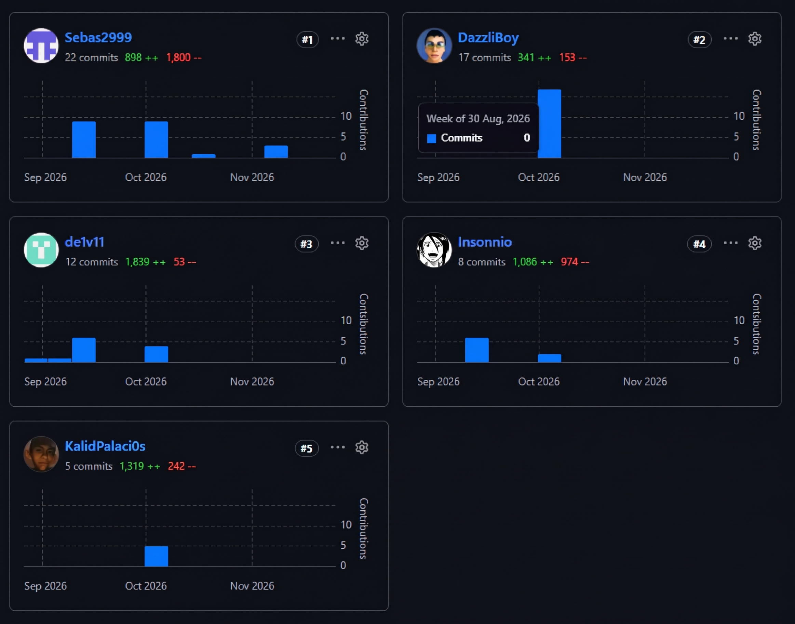

   
# Universidad Peruana de Ciencias Aplicadas

# Carrera de Ingeniería de Software

### 1ASI0572

### Desarrollo de Soluciones IoT

### NRC 

### 8725

### Informe del Trabajo Final

### Docente

### León Baca, Marco Antonio

### Equipo

### AgroLeak

### Proyecto

### AgroTech

### Integrantes:

| Código | Apellidos y Nombres |
| :--- | :--- |
| U202117475 | Dueñas Canales, Leonardo Manuel |
| U201611430 | Flores Manrique, Sebastian |
| U202516291 | Meza Tataje, David |
| U201913639 | Palacios Jauregui, Kalid |
| U202222846 | Ramos Calagua, Sebastian Alexander|

### Período 202620

# Registro de Versiones del Informe

| Versión | Fecha | Autor | Descripción de modificación |
| :---: | :---: | :--- | :--- |
| 0.1.0 | 12/09/2026 | Meza Tataje, David | Creación del repositorio del informe y de la estructura base: carátula y un archivo Markdown por capítulo. |
| 0.2.0 | 19/09/2026 | Meza Tataje, David | Capítulo I: Startup Profile, perfil de Kalid Palacios, Lean UX Process y Lean UX Canvas. Capítulo II: logos de competidores, diseño de entrevistas (2.2.1) y paso 2 del Big Picture EventStorming. |
| 0.3.0 | 19/09/2026 | Dueñas Canales, Leonardo Manuel | Capítulo I: perfil y fotografía propios. Capítulo III: User Stories, Impact Mapping y Product Backlog. |
| 0.4.0 | 19/09/2026 | Flores Manrique, Sebastian Enrique | Capítulo IV: Design-Level EventStorming, Context Mapping y bounded contexts Irrigation, Pest Monitoring, Safety y Alerts. Capítulo V: primera versión. Perfil de integrante y Student Outcome (AV1). |
| 1.0.0 | 04/10/2026 | Palacios Jauregui, Kalid | Capítulo II: registro de entrevistas de needfinding. |
| 1.1.0 | 08/10/2026 | Palacios Jauregui, Kalid | Capítulo II: Needfinding en UXPressia y Big Picture EventStorming en Miro; descripción de los bounded contexts relacionados mediante políticas. |
| 1.2.0 | 08/10/2026 | Meza Tataje, David | Capítulo II: Big Picture EventStorming completo (pasos 1 al 10), imágenes de needfinding, entrevista adicional y Ubiquitous Language. Capítulo V: wireframes, mock-ups y actualización de la sección 5.6. |
| 1.3.0 | 08/10/2026 | Dueñas Canales, Leonardo Manuel | Capítulo III: actualización de User Stories y Product Backlog; corrección de observaciones. |
| 1.4.0 | 08/10/2026 | Flores Manrique, Sebastian Enrique | Capítulo II: corrección de entrevistas. Capítulo IV: Bounded Context Canvases, diagramas C4 de componentes, diagramas de clases y de base de datos. Student Outcome (TB1). |
| 1.5.0 | 08/10/2026 | Ramos Calagua, Sebastian Alexander | Capítulo I: actualización de perfiles. Capítulo II: entrevista 2, análisis de entrevistas, User Persona y matrices de needfinding. Capítulo VI: configuración del entorno, Sprint 1 y evidencias del Sprint Review. |
| 2.0.0 | 23/10/2026 | Flores Manrique, Sebastian Enrique | Carátula: actualización de los datos del curso y del proyecto. |
| 2.1.0 | 14/11/2026 | Flores Manrique, Sebastian Enrique | Capítulo VI: Sprint 2 (6.2.2). Student Outcome (AV2). |
| 3.0.0 | 25/11/2026 | Flores Manrique, Sebastian Enrique | Carátula: Registro de Versiones alineado con el historial de commits, Project Report Collaboration Insights por entrega, tabla de contenidos a cuatro niveles y corrección del Student Outcome. |

# Project Report Collaboration Insights

El informe se elabora de forma colaborativa en Markdown dentro de la organización pública de GitHub del equipo. Cada capítulo está en un archivo de la carpeta `docs/` y las imágenes se almacenan en `assets/`.

| Producto | Repositorio |
| :--- | :--- |
| Project Report | [https://github.com/upc-pre-202620-AgroLeak-Final-Project/Project-report](https://github.com/upc-pre-202620-AgroLeak-Final-Project/Project-report) |
| Landing Page | [https://github.com/upc-pre-202620-AgroLeak-Final-Project/Landing-page-AgroLeak](https://github.com/upc-pre-202620-AgroLeak-Final-Project/Landing-page-AgroLeak) |
| Web Services (RESTful API) | [https://github.com/upc-pre-202620-AgroLeak-Final-Project/AgroLeak-backend](https://github.com/upc-pre-202620-AgroLeak-Final-Project/AgroLeak-backend) |
| Frontend Web Application | [https://github.com/upc-pre-202620-AgroLeak-Final-Project/AgroLeak-webapp](https://github.com/upc-pre-202620-AgroLeak-Final-Project/AgroLeak-webapp) |
| Mobile Application | [https://github.com/upc-pre-202620-AgroLeak-Final-Project/AgroLeak-android](https://github.com/upc-pre-202620-AgroLeak-Final-Project/AgroLeak-android) |
| Embedded Application | [https://github.com/upc-pre-202620-AgroLeak-Final-Project/Embedded-system-AgroLeak](https://github.com/upc-pre-202620-AgroLeak-Final-Project/Embedded-system-AgroLeak) |
<!-- | Edge API | agregar el enlace cuando exista el repositorio | -->

**Organización del trabajo.** Cada integrante trabaja en una rama por sección del informe (`feature/caratula`, `feature/chapter-1` a `feature/chapter-6` y `feature/conclusiones-referencias`). Los cambios se integran en `main` mediante Pull Requests, y los mensajes de commit siguen Conventional Commits con el tipo `docs:`.

**Integrantes y usuarios de GitHub**

| Integrante | Usuario(s) de GitHub |
| :--- | :--- |
| Dueñas Canales, Leonardo Manuel | Insonnio |
| Flores Manrique, Sebastian Enrique | Sebas2999 |
| Meza Tataje, David | de1v11 |
| Palacios Jauregui, Kalid | KalidPalaci0s |
| Ramos Calagua, Sebastian Alexander | DazzliBoy |

## AV1 (12/09/2026 – 19/09/2026)

El equipo creó el repositorio y la estructura base del informe, y elaboró los capítulos I al V en ramas independientes por capítulo. El 19/09/2026 se integraron mediante los Pull Requests #1 al #6. En esta entrega se registraron 23 commits: de1v11 (8), sebastian (9) e Insonnio (6).

<!-- CAPTURA AV1: Insights > Contributors filtrado del 12/09/2026 al 19/09/2026 -->
<!--  -->

## TB1 (20/09/2026 – 08/10/2026)

El equipo registró las entrevistas en la rama `ENTREVISTAS` (Pull Request #7), completó el needfinding, el Big Picture EventStorming y los diagramas tácticos del capítulo IV, e incorporó el capítulo VI con el Sprint 1. Los aportes se integraron mediante los Pull Requests #8 al #14. En esta entrega se registraron 37 commits: DazzliBoy (17), sebastian (9), KalidPalaci0s (5), de1v11 (4) e Insonnio (2).

<!-- CAPTURA TB1: Insights > Contributors filtrado del 20/09/2026 al 08/10/2026 -->
<!--  -->

## AV2 (09/10/2026 – 14/11/2026)

Se actualizó la carátula y se incorporó el Sprint 2 en el capítulo VI, junto con el Student Outcome de AV2. Los cambios se integraron mediante los Pull Requests #15 y #16. En esta entrega se registraron 4 commits de Sebas2999.

<!-- CAPTURA AV2: Insights > Contributors filtrado del 09/10/2026 al 14/11/2026 -->
<!--  -->

## TB2 (15/11/2026 – fecha de entrega)

<!-- Completar al cerrar TB2: qué se corrigió y agregó, Pull Requests, cantidad de commits por usuario. -->

<!-- CAPTURA TB2: Insights > Contributors filtrado desde el 15/11/2026 -->
<!--  -->

<!-- CAPTURA GENERAL: Pull requests cerrados del repositorio -->
<!--  -->

# Contenido

## Tabla de contenidos

* [Registro de Versiones del Informe](#registro-de-versiones-del-informe)
* [Project Report Collaboration Insights](#project-report-collaboration-insights)
* [Student Outcome](#student-outcome)
* [Capítulo I: Introducción](01-capitulo-1.md#capítulo-i-introducción)
    * [1.1. Startup Profile](01-capitulo-1.md#11-startup-profile)
        * [1.1.1. Descripción de la Startup](01-capitulo-1.md#111-descripción-de-la-startup)
        * [1.1.2. Perfiles de integrantes del equipo](01-capitulo-1.md#112-perfiles-de-integrantes-del-equipo)
    * [1.2. Solution Profile](01-capitulo-1.md#12-solution-profile)
        * [1.2.1. Antecedentes y problemática](01-capitulo-1.md#121-antecedentes-y-problemática)
        * [1.2.2. Lean UX Process](01-capitulo-1.md#122-lean-ux-process)
            * [1.2.2.1. Lean UX Problem Statements](01-capitulo-1.md#1221-lean-ux-problem-statements)
            * [1.2.2.2. Lean UX Assumptions](01-capitulo-1.md#1222-lean-ux-assumptions)
            * [1.2.2.3. Lean UX Hypothesis Statements](01-capitulo-1.md#1223-lean-ux-hypothesis-statements)
            * [1.2.2.4. Lean UX Canvas](01-capitulo-1.md#1224-lean-ux-canvas)
    * [1.3. Segmentos objetivo](01-capitulo-1.md#13-segmentos-objetivo)
* [Capítulo II: Requirements Elicitation & Analysis](02-capitulo-2.md#capítulo-ii-requirements-elicitation--analysis)
    * [2.1. Competidores](02-capitulo-2.md#21-competidores)
        * [2.1.1. Análisis competitivo](02-capitulo-2.md#211-análisis-competitivo)
        * [2.1.2. Estrategias y tácticas frente a competidores](02-capitulo-2.md#212-estrategias-y-tácticas-frente-a-competidores)
    * [2.2. Entrevistas](02-capitulo-2.md#22-entrevistas)
        * [2.2.1. Diseño de entrevistas](02-capitulo-2.md#221-diseño-de-entrevistas)
        * [2.2.2. Registro de entrevistas](02-capitulo-2.md#222-registro-de-entrevistas)
        * [2.2.3. Análisis de entrevistas](02-capitulo-2.md#223-análisis-de-entrevistas)
    * [2.3. Needfinding](02-capitulo-2.md#23-needfinding)
        * [2.3.1. User Personas](02-capitulo-2.md#231-user-personas)
        * [2.3.2. User Task Matrix](02-capitulo-2.md#232-user-task-matrix)
        * [2.3.3. User Journey Mapping](02-capitulo-2.md#233-user-journey-mapping)
        * [2.3.4. Empathy Mapping](02-capitulo-2.md#234-empathy-mapping)
    * [2.4. Big Picture Event Storming](02-capitulo-2.md#24-big-picture-event-storming)
    * [2.5. Ubiquitous Language](02-capitulo-2.md#25-ubiquitous-language)
* [Capítulo III: Requirements Specification](03-capitulo-3.md#capítulo-iii-requirements-specification)
    * [3.1 User Stories](03-capitulo-3.md#31-user-stories)
    * [3.2 Impact Mapping](03-capitulo-3.md#32-impact-mapping)
    * [3.3 Product Backlog](03-capitulo-3.md#33-product-backlog)
* [Capítulo IV: Solution Software Design](04-capitulo-4.md#capítulo-iv-solution-software-design)
    * [4.1. Strategic-Level Domain-Driven Design](04-capitulo-4.md#41-strategic-level-domain-driven-design)
        * [4.1.1. Design-Level EventStorming](04-capitulo-4.md#411-design-level-eventstorming)
            * [4.1.1.1. Candidate Context Discovery](04-capitulo-4.md#4111-candidate-context-discovery)
            * [4.1.1.2. Domain Message Flows Modeling](04-capitulo-4.md#4112-domain-message-flows-modeling)
            * [4.1.1.3. Bounded Context Canvases](04-capitulo-4.md#4113-bounded-context-canvases)
        * [4.1.2. Context Mapping](04-capitulo-4.md#412-context-mapping)
        * [4.1.3. Software Architecture](04-capitulo-4.md#413-software-architecture)
            * [4.1.3.1. Software Architecture System Landscape Diagram](04-capitulo-4.md#4131-software-architecture-system-landscape-diagram)
            * [4.1.3.2. Software Architecture Context Level Diagrams](04-capitulo-4.md#4132-software-architecture-context-level-diagrams)
            * [4.1.3.3. Software Architecture Container Level Diagrams](04-capitulo-4.md#4133-software-architecture-container-level-diagrams)
            * [4.1.3.4. Software Architecture Deployment Diagrams](04-capitulo-4.md#4134-software-architecture-deployment-diagrams)
    * [4.2. Tactical-Level Domain-Driven Design](04-capitulo-4.md#42-tactical-level-domain-driven-design)
        * [4.2.1. Bounded Context: IAM](04-capitulo-4.md#421-bounded-context-iam)
            * [4.2.1.1. Domain Layer](04-capitulo-4.md#4211-domain-layer)
            * [4.2.1.2. Interface Layer](04-capitulo-4.md#4212-interface-layer)
            * [4.2.1.3. Application Layer](04-capitulo-4.md#4213-application-layer)
            * [4.2.1.4. Infrastructure Layer](04-capitulo-4.md#4214-infrastructure-layer)
            * [4.2.1.5. Bounded Context Software Architecture Component Level Diagrams](04-capitulo-4.md#4215-bounded-context-software-architecture-component-level-diagrams)
            * [4.2.1.6. Bounded Context Software Architecture Code Level Diagrams](04-capitulo-4.md#4216-bounded-context-software-architecture-code-level-diagrams)
        * [4.2.2. Bounded Context: Farm Management](04-capitulo-4.md#422-bounded-context-farm-management)
            * [4.2.2.1. Domain Layer](04-capitulo-4.md#4221-domain-layer)
            * [4.2.2.2. Interface Layer](04-capitulo-4.md#4222-interface-layer)
            * [4.2.2.3. Application Layer](04-capitulo-4.md#4223-application-layer)
            * [4.2.2.4. Infrastructure Layer](04-capitulo-4.md#4224-infrastructure-layer)
            * [4.2.2.5. Bounded Context Software Architecture Component Level Diagrams](04-capitulo-4.md#4225-bounded-context-software-architecture-component-level-diagrams)
            * [4.2.2.6. Bounded Context Software Architecture Code Level Diagrams](04-capitulo-4.md#4226-bounded-context-software-architecture-code-level-diagrams)
        * [4.2.3. Bounded Context: Devices](04-capitulo-4.md#423-bounded-context-devices)
            * [4.2.3.1. Domain Layer](04-capitulo-4.md#4231-domain-layer)
            * [4.2.3.2. Interface Layer](04-capitulo-4.md#4232-interface-layer)
            * [4.2.3.3. Application Layer](04-capitulo-4.md#4233-application-layer)
            * [4.2.3.4. Infrastructure Layer](04-capitulo-4.md#4234-infrastructure-layer)
            * [4.2.3.5. Bounded Context Software Architecture Component Level Diagrams](04-capitulo-4.md#4235-bounded-context-software-architecture-component-level-diagrams)
            * [4.2.3.6. Bounded Context Software Architecture Code Level Diagrams](04-capitulo-4.md#4236-bounded-context-software-architecture-code-level-diagrams)
        * [4.2.4. Bounded Context: Monitoring](04-capitulo-4.md#424-bounded-context-monitoring)
            * [4.2.4.1. Domain Layer](04-capitulo-4.md#4241-domain-layer)
            * [4.2.4.2. Interface Layer](04-capitulo-4.md#4242-interface-layer)
            * [4.2.4.3. Application Layer](04-capitulo-4.md#4243-application-layer)
            * [4.2.4.4. Infrastructure Layer](04-capitulo-4.md#4244-infrastructure-layer)
            * [4.2.4.5. Bounded Context Software Architecture Component Level Diagrams](04-capitulo-4.md#4245-bounded-context-software-architecture-component-level-diagrams)
            * [4.2.4.6. Bounded Context Software Architecture Code Level Diagrams](04-capitulo-4.md#4246-bounded-context-software-architecture-code-level-diagrams)
        * [4.2.5. Bounded Context: Irrigation](04-capitulo-4.md#425-bounded-context-irrigation)
            * [4.2.5.1. Domain Layer](04-capitulo-4.md#4251-domain-layer)
            * [4.2.5.2. Interface Layer](04-capitulo-4.md#4252-interface-layer)
            * [4.2.5.3. Application Layer](04-capitulo-4.md#4253-application-layer)
            * [4.2.5.4. Infrastructure Layer](04-capitulo-4.md#4254-infrastructure-layer)
            * [4.2.5.5. Bounded Context Software Architecture Component Level Diagrams](04-capitulo-4.md#4255-bounded-context-software-architecture-component-level-diagrams)
        * [4.2.6. Bounded Context: Pest Monitoring](04-capitulo-4.md#426-bounded-context-pest-monitoring)
            * [4.2.6.1. Domain Layer](04-capitulo-4.md#4261-domain-layer)
            * [4.2.6.2. Interface Layer](04-capitulo-4.md#4262-interface-layer)
            * [4.2.6.3. Application Layer](04-capitulo-4.md#4263-application-layer)
            * [4.2.6.4. Infrastructure Layer](04-capitulo-4.md#4264-infrastructure-layer)
            * [4.2.6.5. Bounded Context Software Architecture Component Level Diagrams](04-capitulo-4.md#4265-bounded-context-software-architecture-component-level-diagrams)
        * [4.2.7. Bounded Context: Alerts](04-capitulo-4.md#427-bounded-context-alerts)
            * [4.2.7.1. Domain Layer](04-capitulo-4.md#4271-domain-layer)
            * [4.2.7.2. Interface Layer](04-capitulo-4.md#4272-interface-layer)
            * [4.2.7.3. Application Layer](04-capitulo-4.md#4273-application-layer)
            * [4.2.7.4. Infrastructure Layer](04-capitulo-4.md#4274-infrastructure-layer)
            * [4.2.7.5. Bounded Context Software Architecture Component Level Diagrams](04-capitulo-4.md#4275-bounded-context-software-architecture-component-level-diagrams)
        * [4.2.8. Bounded Context: Analytics](04-capitulo-4.md#428-bounded-context-analytics)
            * [4.2.8.1. Domain Layer](04-capitulo-4.md#4281-domain-layer)
            * [4.2.8.2. Interface Layer](04-capitulo-4.md#4282-interface-layer)
            * [4.2.8.3. Application Layer](04-capitulo-4.md#4283-application-layer)
            * [4.2.8.4. Infrastructure Layer](04-capitulo-4.md#4284-infrastructure-layer)
            * [4.2.8.5. Bounded Context Software Architecture Component Level Diagrams](04-capitulo-4.md#4285-bounded-context-software-architecture-component-level-diagrams)
* [Capítulo V: Solution UI/UX Design](05-capitulo-5.md#capítulo-v-solution-uiux-design)
    * [5.1. Style Guidelines](05-capitulo-5.md#51-style-guidelines)
        * [5.1.1. General Style Guidelines](05-capitulo-5.md#511-general-style-guidelines)
        * [5.1.2. Web, Mobile and IoT Style Guidelines](05-capitulo-5.md#512-web-mobile-and-iot-style-guidelines)
    * [5.2. Information Architecture](05-capitulo-5.md#52-information-architecture)
        * [5.2.1. Organization Systems](05-capitulo-5.md#521-organization-systems)
        * [5.2.2. Labeling Systems](05-capitulo-5.md#522-labeling-systems)
        * [5.2.3. SEO Tags and Meta Tags](05-capitulo-5.md#523-seo-tags-and-meta-tags)
        * [5.2.4. Searching Systems](05-capitulo-5.md#524-searching-systems)
        * [5.2.5. Navigation Systems](05-capitulo-5.md#525-navigation-systems)
    * [5.3. Landing Page UI Design](05-capitulo-5.md#53-landing-page-ui-design)
        * [5.3.1. Landing Page Wireframe](05-capitulo-5.md#531-landing-page-wireframe)
        * [5.3.2. Landing Page Mock-up](05-capitulo-5.md#532-landing-page-mock-up)
    * [5.4. Applications UX/UI Design](05-capitulo-5.md#54-applications-uxui-design)
        * [5.4.1. Applications Wireframes](05-capitulo-5.md#541-applications-wireframes)
        * [5.4.2. Applications Wireflow Diagrams](05-capitulo-5.md#542-applications-wireflow-diagrams)
        * [5.4.3. Applications Mock-ups](05-capitulo-5.md#543-applications-mock-ups)
        * [5.4.4. Applications User Flow Diagrams](05-capitulo-5.md#544-applications-user-flow-diagrams)
    * [5.5. Applications Prototyping](05-capitulo-5.md#55-applications-prototyping)
    * [5.6. IoT Device Design](05-capitulo-5.md#56-iot-device-design)
        * [5.6.1. Flujo de funcionamiento del dispositivo](05-capitulo-5.md#561-flujo-de-funcionamiento-del-dispositivo)
        * [5.6.2. Diseño físico de los dispositivos IoT](05-capitulo-5.md#562-diseño-físico-de-los-dispositivos-iot)
        * [5.6.3. Diagramas de circuito y simulación](05-capitulo-5.md#563-diagramas-de-circuito-y-simulación)
* [Capítulo VI: Product Implementation, Validation & Deployment](06-capitulo-6.md#capítulo-vi-product-implementation-validation--deployment)
    * [6.1. Software Configuration Management](06-capitulo-6.md#61-software-configuration-management)
        * [6.1.1. Software Development Environment Configuration](06-capitulo-6.md#611-software-development-environment-configuration)
        * [6.1.2. Source Code Management](06-capitulo-6.md#612-source-code-management)
        * [6.1.3. Source Code Style Guide & Conventions](06-capitulo-6.md#613-source-code-style-guide--conventions)
        * [6.1.4. Software Deployment Configuration](06-capitulo-6.md#614-software-deployment-configuration)
    * [6.2. Landing Page, Services & Applications Implementation](06-capitulo-6.md#62-landing-page-services--applications-implementation)
        * [6.2.1. Sprint 1](06-capitulo-6.md#621-sprint-1)
            * [6.2.1.1. Sprint Planning 1](06-capitulo-6.md#6211-sprint-planning-1)
            * [6.2.1.2. Aspect Leaders and Collaborators](06-capitulo-6.md#6212-aspect-leaders-and-collaborators)
            * [6.2.1.3. Sprint Backlog 1](06-capitulo-6.md#6213-sprint-backlog-1)
            * [6.2.1.4. Development Evidence for Sprint Review](06-capitulo-6.md#6214-development-evidence-for-sprint-review)
            * [6.2.1.5. Testing Suite Evidence for Sprint Review](06-capitulo-6.md#6215-testing-suite-evidence-for-sprint-review)
            * [6.2.1.6. Execution Evidence for Sprint Review](06-capitulo-6.md#6216-execution-evidence-for-sprint-review)
            * [6.2.1.7. Services Documentation Evidence for Sprint Review](06-capitulo-6.md#6217-services-documentation-evidence-for-sprint-review)
            * [6.2.1.8. Software Deployment Evidence for Sprint Review](06-capitulo-6.md#6218-software-deployment-evidence-for-sprint-review)
            * [6.2.1.9. Team Collaboration Insights during Sprint](06-capitulo-6.md#6219-team-collaboration-insights-during-sprint)
        * [6.2.2. Sprint 2](06-capitulo-6.md#622-sprint-2)
            * [6.2.2.1. Sprint Planning 2](06-capitulo-6.md#6221-sprint-planning-2)
            * [6.2.2.2. Aspect Leaders and Collaborators](06-capitulo-6.md#6222-aspect-leaders-and-collaborators)
            * [6.2.2.3. Sprint Backlog 2](06-capitulo-6.md#6223-sprint-backlog-2)
            * [6.2.2.4. Development Evidence for Sprint Review](06-capitulo-6.md#6224-development-evidence-for-sprint-review)
            * [6.2.2.5. Testing Suite Evidence for Sprint Review](06-capitulo-6.md#6225-testing-suite-evidence-for-sprint-review)
            * [6.2.2.6. Execution Evidence for Sprint Review](06-capitulo-6.md#6226-execution-evidence-for-sprint-review)
            * [6.2.2.7. Services Documentation Evidence for Sprint Review](06-capitulo-6.md#6227-services-documentation-evidence-for-sprint-review)
            * [6.2.2.8. Software Deployment Evidence for Sprint Review](06-capitulo-6.md#6228-software-deployment-evidence-for-sprint-review)
            * [6.2.2.9. Team Collaboration Insights during Sprint](06-capitulo-6.md#6229-team-collaboration-insights-during-sprint)
        * [6.2.3. Sprint 3](06-capitulo-6.md#623-sprint-3)
            * [6.2.3.1. Sprint Planning 3](06-capitulo-6.md#6231-sprint-planning-3)
            * [6.2.3.2. Aspect Leaders and Collaborators](06-capitulo-6.md#6232-aspect-leaders-and-collaborators)
            * [6.2.3.3. Sprint Backlog 3](06-capitulo-6.md#6233-sprint-backlog-3)
            * [6.2.3.4. Development Evidence for Sprint Review](06-capitulo-6.md#6234-development-evidence-for-sprint-review)
            * [6.2.3.5. Testing Suite Evidence for Sprint Review](06-capitulo-6.md#6235-testing-suite-evidence-for-sprint-review)
            * [6.2.3.6. Execution Evidence for Sprint Review](06-capitulo-6.md#6236-execution-evidence-for-sprint-review)
            * [6.2.3.7. Services Documentation Evidence for Sprint Review](06-capitulo-6.md#6237-services-documentation-evidence-for-sprint-review)
            * [6.2.3.8. Software Deployment Evidence for Sprint Review](06-capitulo-6.md#6238-software-deployment-evidence-for-sprint-review)
            * [6.2.3.9. Team Collaboration Insights during Sprint](06-capitulo-6.md#6239-team-collaboration-insights-during-sprint)
    * [6.3. Validation Interviews](06-capitulo-6.md#63-validation-interviews)
        * [6.3.1. Diseño de Entrevistas](06-capitulo-6.md#631-diseño-de-entrevistas)
        * [6.3.2. Registro de Entrevistas](06-capitulo-6.md#632-registro-de-entrevistas)
        * [6.3.3. Evaluaciones según heurísticas](06-capitulo-6.md#633-evaluaciones-según-heurísticas)
    * [6.4. Video About-the-Product](06-capitulo-6.md#64-video-about-the-product)
* [Conclusiones](07-conclusiones-referencias.md#conclusiones)
    * [Conclusiones y recomendaciones](07-conclusiones-referencias.md#conclusiones-y-recomendaciones)
    * [Video About-the-Team](07-conclusiones-referencias.md#video-about-the-team)
* [Bibliografía](07-conclusiones-referencias.md#bibliografía)
* [Anexos](07-conclusiones-referencias.md#anexos)
    * [Anexo A. Videos de Exposiciones](07-conclusiones-referencias.md#anexo-a-videos-de-exposiciones)

## Student Outcome

**ABET - EAC - Student Outcome 5**

**Criterio:** La capacidad de funcionar efectivamente en un equipo cuyos miembros juntos proporcionan liderazgo, crean un entorno de colaboración e inclusivo, establecen objetivos, planifican tareas y cumplen objetivos.

En el siguiente cuadro se describe las acciones realizadas y enunciados de conclusiones por parte del grupo, que permiten sustentar el haber alcanzado el logro del ABET – EAC - Student Outcome 5.

| Criterio específico | Acciones realizadas | Conclusiones |
|---|---|---|
| **Trabaja en equipo para proporcionar liderazgo en forma conjunta** | **Meza Tataje, David**  **AV1** Asumí el liderazgo en la definición de la arquitectura de software, guiando al equipo en la elaboración de los diagramas C4 Model y el diseño de nivel estratégico y táctico (DDD).  **TB1** Asumí el liderazgo en la definición de la gestión de la configuración del software, estableciendo la estructuración de los entornos de desarrollo y las directrices para el control del código fuente de todo el equipo.  **AV2** Lideré la configuración del despliegue de la Web Application y del backend en la nube, y mantuve el flujo GitFlow y los pipelines de CI/CD, revisando los Pull Requests para asegurar la integración continua del trabajo del equipo.  **Flores Manrique, Sebastian**  **AV1** Lideré el diseño de la experiencia de usuario, definiendo las guías de estilo, la arquitectura de información y dirigiendo la implementación técnica de la primera versión funcional del Landing Page.  **TB1** Lideré la consolidación del diseño de interfaces y experiencia de usuario de la solución, dirigiendo además la implementación técnica y el despliegue a producción de la primera versión de nuestras aplicaciones web frontend y del Landing Page.  **AV2** Lideré la implementación en Angular de las vistas de fundos, dispositivos, monitoreo y alertas de la Web Application, y la actualización del Landing Page, manteniendo la coherencia con las guías de estilo definidas.  **Dueñas Canales, Leonardo Manuel**  **AV1** Encabecé la fase de investigación y elicitación, conduciendo el análisis competitivo, el proceso Lean UX y la estructuración del EventStorming junto con el equipo.  **TB1** Dirigí la gestión ágil de la implementación del producto, encabezando la planificación del primer Sprint, la asignación de líderes de aspectos y colaboradores, y la estructuración de la pila de tareas (Backlog) a desarrollar.  **AV2** Dirigí la planificación del Sprint 2 y la implementación de los bounded contexts Farm Management, Monitoring y Alerts en el backend, incluyendo la lógica de detección de anomalías persistentes de caudal.  **Palacios Jauregui, Kalid**  **AV1** Dirigí la especificación de requisitos, estableciendo los estándares para la redacción de User Stories y liderando la priorización del Product Backlog para el MVP.  **TB1** Encabecé la recopilación y estructuración técnica de las evidencias de desarrollo, pruebas, ejecución y documentación de servicios, garantizando la preparación integral para la revisión del Sprint.  **AV2** Encabecé el seguimiento del Sprint 2 como Scrum Master, el refinamiento del Product Backlog y la recopilación de las evidencias de desarrollo, pruebas, ejecución y despliegue para el Sprint Review.  **Ramos Calagua, Sebastian Alexander**  **AV1** Asumí el liderazgo en la investigación preliminar de requerimientos físicos para IoT, evaluando la viabilidad de integración con nuestro ecosistema de software.  **TB1** Dirigí la configuración y documentación del despliegue de software y estructuré las evidencias de dicho despliegue para asegurar la estabilidad de los pases a producción en los servicios implementados.  **AV2** Dirigí las migraciones de base de datos con Flyway, la gestión de dispositivos y su sincronización con el Edge API, así como la ejecución de las pruebas automatizadas y la documentación de los servicios. | **AV1** Durante la elaboración del informe AV1, demostramos un liderazgo compartido efectivo al distribuir la dirección de la investigación y diseño inicial según nuestras fortalezas técnicas. Esta delegación nos permitió profundizar en áreas complejas como el diseño IoT, la arquitectura de software y la implementación inicial del Landing Page, asegurando resultados de alta calidad.  **TB1** Para esta entrega, el liderazgo compartido se adaptó a las altas exigencias de implementación técnica. La incorporación de un nuevo integrante nos permitió fortalecer áreas clave. Distribuimos la dirección para abarcar simultáneamente el diseño avanzado de interfaces, la gestión rigurosa de la configuración del código y la ejecución metodológica del primer Sprint, logrando desplegar con éxito nuestras aplicaciones web y servicios en la nube.  **AV2** En esta entrega, el liderazgo compartido se centró en consolidar el núcleo operativo del producto. Cada integrante dirigió un aspecto del Sprint 2 según su especialidad: despliegue y configuración, interfaces en Angular, lógica de negocio en el backend, seguimiento ágil y validación de datos y pruebas. Esta distribución permitió desplegar la primera versión de la Web Application integrada con el backend y el Edge API. |
| **Crea un entorno colaborativo e inclusivo, establece metas, planifica tareas y cumple objetivos.** | **Meza Tataje, David**  **AV1** Planifiqué el flujo de control de versiones en GitHub para el informe y el código, estableciendo convenciones claras que facilitaron la integración del trabajo de todos los miembros sin conflictos.  **TB1** Planifiqué y coordiné la actualización del registro de versiones del informe y los hallazgos de colaboración del equipo (Project Report Collaboration Insights), asegurando que los aportes se integren de forma cohesiva y cumplan las metas de la entrega.  **AV2** Coordiné la actualización del registro de versiones del informe y del Project Report Collaboration Insights, y establecí la revisión de Pull Requests como requisito para integrar los aportes del Sprint 2 en la rama develop.  **Flores Manrique, Sebastian**  **AV1** Aseguré un entorno inclusivo al integrar principios de accesibilidad (a11y) en el Landing Page y coordiné el espacio de trabajo colaborativo en herramientas de diseño, permitiendo la revisión conjunta de los mock-ups.  **TB1** Establecí las convenciones y guías de estilo para el código fuente, promoviendo un código limpio y estandarizado, y organicé sesiones de refactorización para lograr las versiones corregidas y mejoradas de los artefactos presentados previamente.  **AV2** Organicé sesiones de revisión conjunta de las interfaces de la Web Application, promoviendo la coherencia visual y la accesibilidad, y coordiné las correcciones de los artefactos de diseño presentados en entregas anteriores.  **Dueñas Canales, Leonardo Manuel**  **AV1** Establecí las metas a corto plazo para la redacción del informe, organizando las sesiones de trabajo síncronas y consolidando los aportes individuales para asegurar la coherencia inicial del proyecto.  **TB1** Facilité un entorno inclusivo al consolidar las retrospectivas del equipo para redactar las métricas de colaboración durante el Sprint, y establecí el cronograma para cumplir puntualmente con la fase de implementación, validación y despliegue del producto.  **AV2** Facilité la retrospectiva del Sprint 2 y consolidé las métricas de colaboración, además de establecer el cronograma de implementación y la asignación de historias de usuario entre los integrantes según sus fortalezas.  **Palacios Jauregui, Kalid**  **AV1** Planifiqué y monitoreé las tareas del equipo utilizando herramientas de gestión ágil, asegurando que los objetivos de investigación, diseño y desarrollo web inicial se cumplieran dentro de los plazos establecidos.  **TB1** Supervisé la actualización de la sección Student Outcome y establecí métricas de revisión cruzada para confirmar que las correcciones aplicadas a los artefactos de entregas anteriores cumplieran con los estándares de calidad esperados.  **AV2** Supervisé la actualización de la sección Student Outcome y verifiqué mediante revisión cruzada que las correcciones de los artefactos previos cumplieran los criterios de calidad, además de monitorear el avance del Sprint 2 en el tablero ágil.  **Ramos Calagua, Sebastian Alexander**  **AV1** Colaboré en la estructuración de la documentación inicial y establecí canales de comunicación técnica asíncrona para facilitar las decisiones arquitectónicas.  **TB1** Trabajé activamente apoyando al equipo en la integración de la primera versión de las aplicaciones web frontend, garantizando que el entorno colaborativo se mantuviera enfocado y alineado con las metas de despliegue planificadas para este ciclo.  **AV2** Apoyé la integración entre la Web Application y los servicios del backend, y documenté el despliegue y las pruebas del Sprint 2 para mantener al equipo alineado con las metas de la entrega. | **AV1** Logramos consolidar un entorno de trabajo altamente colaborativo, apoyándonos en herramientas en la nube y repositorios compartidos para mantener la visibilidad del progreso. La planificación estructurada de tareas y el establecimiento de hitos internos nos permitieron cumplir con todos los objetivos planteados para la fase inicial del proyecto.  **TB1** En esta etapa, fortalecimos nuestro entorno colaborativo implementando convenciones formales de código y de gestión de configuración. Logramos cumplir todas las metas establecidas: desde la actualización y mejora sustancial de los artefactos previos, hasta la ejecución íntegra del primer Sprint con sus respectivas evidencias de pruebas y despliegue. Esta planificación conjunta unificó nuestro flujo de trabajo de manera transparente.  **AV2** En esta entrega, consolidamos el entorno colaborativo mediante la revisión obligatoria de Pull Requests, retrospectivas y el seguimiento en el tablero ágil. Cumplimos las metas del Sprint 2: el despliegue de la primera versión de la Web Application, la actualización del Landing Page y la corrección y mejora de los artefactos de entregas anteriores. |
