

# Capítulo II: Requirements Elicitation & Analysis

En este capítulo se presenta la investigación de requisitos y el análisis del dominio para el desarrollo de AgroLeak. Se incluye el estudio comparativo de competidores en el mercado AgTech, el diseño y registro de entrevistas a profundidad con representantes de los segmentos objetivo, el proceso de Needfinding (User Personas, Task Matrix, Journey Maps y Empathy Maps), el modelado del negocio mediante Big Picture EventStorming y la definición del lenguaje ubicuo.

---

## 2.1. Competidores

En esta sección se analiza el panorama competitivo de las soluciones tecnológicas orientadas al monitoreo de riego, gestión hídrica y detección de amenazas en cultivos. El análisis permite identificar las principales características, fortalezas, debilidades y vacíos de las alternativas existentes en el mercado, con el propósito de determinar las oportunidades de diferenciación para AgroLeak como un kit IoT de ciclo cerrado accesible con IA en el borde.

### 2.1.1. Análisis competitivo

#### Competitive Analysis Landscape

<table border="1" cellspacing="0" cellpadding="7" width="100%">

<tr>
<th colspan="6" align="left">
Competitive Analysis Landscape
</th>
</tr>

<tr>
<th colspan="2" align="left" valign="middle">
¿Por qué llevar a cabo este análisis?
</th>

<td colspan="4" align="left">
El objetivo del análisis es identificar las brechas existentes entre las plataformas de telemetría industrial de alto costo y las herramientas de monitoreo satelital, reconociendo oportunidades de diferenciación que posicionen a AgroLeak como un kit IoT accesible, de ciclo cerrado y con procesamiento en el borde (detección diferencial de caudal y visión por computador para plagas) para pequeños y medianos agricultores del Perú.
</td>
</tr>

<tr>

<th colspan="2" align="left" valign="middle">
</th>

<th align="center" valign="middle">
AgroLeak
  
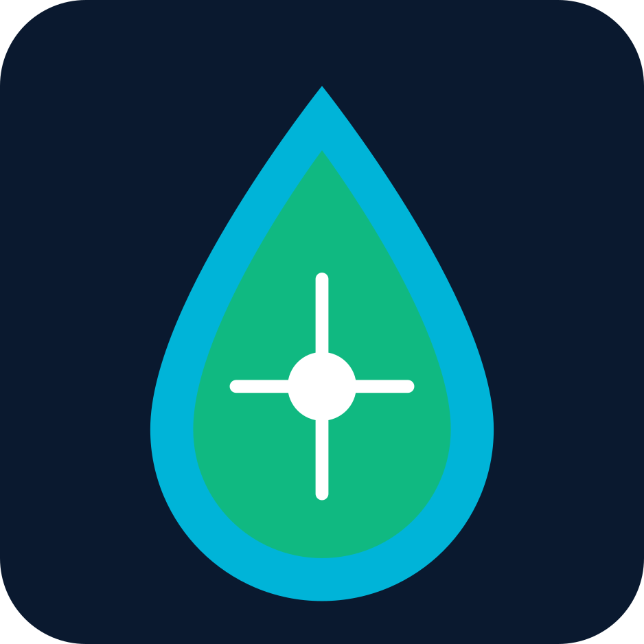
</th>

<th align="center" valign="middle">
DropControl (WiseConn)
  

</th>

<th align="center" valign="middle">
CropX
  

</th>

<th align="center" valign="middle">
Kilimo
  
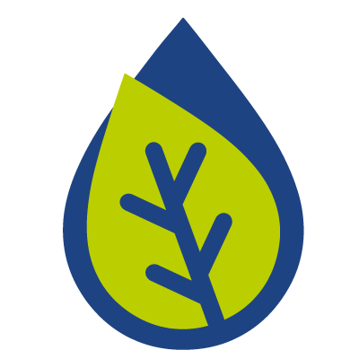
</th>

</tr>

<tr>

<th rowspan="2" align="center" valign="top">
Perfil
</th>

<th align="center" valign="middle">
Overview
</th>

<td valign="top">
Sistema IoT de ciclo cerrado con sensado diferencial de caudal, cámara IoT con visión artificial en el borde y cierre de válvula con confirmación del usuario para prevenir pérdidas por fugas y plagas.
</td>

<td valign="top">
Sistema industrial de telemetría y automatización de riego por radiofrecuencia y la nube para grandes operaciones agrícolas.
</td>

<td valign="top">
Plataforma de monitoreo agronómico basada en sensores de suelo, datos meteorológicos e integración satelital para optimizar el riego.
</td>

<td valign="top">
Plataforma SaaS de gestión de riego basada en imágenes satelitales y datos agrometeorológicos sin necesidad de hardware en campo.
</td>

</tr>

<tr>

<th align="center" valign="middle">
Ventaja competitiva
</th>

<td valign="top">
Solución híbrida accesible (agua + sanidad vegetal) con actuación física de salvaguarda y procesamiento en el borde (Edge AI).
</td>

<td valign="top">
Alta precisión industrial, robustez en hardware de campo y amplia capacidad de automatización de válvulas en grandes extensiones.
</td>

<td valign="top">
Gran capacidad de integración de datos multi-fuente (suelo, clima, satélite) y algoritmos avanzados de recomendación de riego.
</td>

<td valign="top">
Cero costo de instalación de hardware y fácil escalabilidad en grandes superficies agrícolas mediante analítica satelital.
</td>

</tr>

<tr>

<th rowspan="2" align="center" valign="top">
Perfil de Marketing
</th>

<th align="center" valign="middle">
Mercado Objetivo
</th>

<td valign="top">
Pequeños y medianos agricultores tecnificados, jefes de operaciones y administradores de fundo en el Perú.
</td>

<td valign="top">
Grandes agroindustrias, fundos exportadores y corporaciones agrícolas con infraestructura de riego compleja.
</td>

<td valign="top">
Medianos y grandes productores agrícolas que buscan optimizar la fertilización y humedad del suelo.
</td>

<td valign="top">
Grandes productores de cultivos extensivos y agroexportadores orientados a la certificación de huella hídrica.
</td>

</tr>

<tr>

<th align="center" valign="middle">
Estrategias de Marketing
</th>

<td valign="top">
Posicionamiento basado en bajo costo, simplicidad de instalación, enfoque local e integración de protección hídrica y fitosanitaria.
</td>

<td valign="top">
Ventas directas B2B, alianzas con empresas de ingeniería de riego y presencia en ferias agroindustriales internacionales.
</td>

<td valign="top">
Marketing de contenidos científicos, demostraciones de retorno de inversión y alianzas con fabricantes de maquinaria agrícola.
</td>

<td valign="top">
Enfoque en sostenibilidad ambiental, créditos de agua, alianzas corporativas y modelo 100 % software de suscripción.
</td>

</tr>

<tr>

<th rowspan="3" align="center" valign="top">
Perfil de Productos
</th>

<th align="center" valign="middle">
Productos y servicios
</th>

<td valign="top">
Sensado diferencial de caudal por pulsos. 
Cierre remoto de válvula con confirmación y modos de operación. 
Detección de plagas por cámara ESP32-CAM y Edge AI. 
Alertas en tiempo real. 
Dashboard web/móvil responsive. 
Bitácora de eventos y evidencia.
</td>

<td valign="top">
Nodos de campo inalámbricos (RF). 
Control automatizado de válvulas. 
Monitoreo de presión y caudal. 
Plataforma web/móvil de gestión. 
Integración con estaciones meteorológicas.
</td>

<td valign="top">
Sensores espirales de humedad de suelo. 
Telemetría celular/satelital. 
Recomendaciones automáticas de riego. 
Integración con modelos de enfermedad. 
Dashboard analítico.
</td>

<td valign="top">
Balance hídrico satelital. 
Recomendaciones semanales de riego. 
Reportes de eficiencia hídrica. 
Certificación de huella hídrica. 
Plataforma web y móvil.
</td>

</tr>

<tr>

<th align="center" valign="middle">
Precios y costos
</th>

<td valign="top">
Modelo de Kit IoT económico con pago inicial accesible y suscripción SaaS mensual de bajo costo.
</td>

<td valign="top">
Elevada inversión inicial en infraestructura hardware, licencias anuales de software y costo de mantenimiento especializado.
</td>

<td valign="top">
Costo moderado-alto por sensor de suelo e infraestructura de comunicación, más suscripción anual por hectárea.
</td>

<td valign="top">
Suscripción basada puramente en software (SaaS) cobrada por hectárea monitoreada al año.
</td>

</tr>

<tr>

<th align="center" valign="middle">
Canales de distribución
</th>

<td valign="top">
Venta directa web (Landing Page), distribuidores locales de equipos de riego y asociaciones de regantes.
</td>

<td valign="top">
Red de distribuidores autorizados de riego, integradores de tecnología agrícola y representantes comerciales directos.
</td>

<td valign="top">
Venta directa corporativa, distribuidores agrícolas y alianzas con plataformas AgTech socias.
</td>

<td valign="top">
Plataforma web digital, fuerza de ventas B2B y convenios con cooperativas agrícolas.
</td>

</tr>

<tr>

<th rowspan="4" align="center" valign="top">
Análisis SWOT
</th>

<th align="center" valign="middle">
Fortalezas
</th>

<td valign="top">
Solución de ciclo cerrado (Sense-Act). 
Doble propósito (agua + plagas). 
Bajo costo de hardware. 
Trazabilidad de datos en el borde.
</td>

<td valign="top">
Líder en automatización industrial. 
Hardware ultra-robusto. 
Gran alcance de cobertura por RF. 
Marca consolidada.
</td>

<td valign="top">
Tecnología de sensores patentada. 
Fuerte respaldo científico. 
Ecosistema de datos integrado. 
Analítica predictiva madura.
</td>

<td valign="top">
Cero despliegue de hardware. 
Fácil adopción e implementación. 
Escalabilidad inmediata. 
Fuerte enfoque en huella hídrica.
</td>

</tr>

<tr>

<th align="center" valign="middle">
Debilidades
</th>

<td valign="top">
Marca en fase inicial. 
Alcance acotado a parcelas/tramos delimitados en el MVP. 
Menor trayectoria comercial.
</td>

<td valign="top">
Costo inaccesible para pequeños productores. 
Instalación y configuración complejas. 
Sin módulo de visión para plagas foliares.
</td>

<td valign="top">
Requiere instalar sensores físicos de suelo. 
No detecta fugas de tuberías directamente. 
Sin mecanismos de corte automático de flujo.
</td>

<td valign="top">
No detecta roturas físicas o fugas repentinas en tuberías. 
Sin monitoreo in situ de plagas insecto a insecto. 
Dependiente de cobertura de nubes para satélite.
</td>

</tr>

<tr>

<th align="center" valign="middle">
Oportunidades
</th>

<td valign="top">
Alta penetración de internet en zonas rurales peruanas (83 %). 
Creciente necesidad de optimizar agua y reducir agroquímicos. 
Escasa competencia en soluciones IoT duales de bajo costo.
</td>

<td valign="top">
Expansión hacia megaproyectos de agroexportación. 
Integración con sistemas de fertirriego inteligente.
</td>

<td valign="top">
Crecimiento del mercado de agricultura de precisión. 
Expansión en mercados de América Latina.
</td>

<td valign="top">
Aumento de regulaciones ambientales sobre uso del agua. 
Alianzas con empresas multinacionales de alimentos.
</td>

</tr>

<tr>

<th align="center" valign="middle">
Amenazas
</th>

<td valign="top">
Competidores internacionales reduciendo precios. 
Resistencia al cambio tecnológico en agricultores tradicionales. 
Inestabilidad en suministro de componentes electrónicos.
</td>

<td valign="top">
Aparición de alternativas IoT de bajo costo. 
Cambios en estándares de conectividad inalámbrica.
</td>

<td valign="top">
Nuevas tecnologías de sensado remoto no invasivo. 
Competencia de startups locales.
</td>

<td valign="top">
Sensibilidad a la precisión de datos satelitales gratuitos. 
Entrada de competidores con modelos híbridos.
</td>

</tr>

</table>

---

### 2.1.2. Estrategias y tácticas frente a competidores

**1. Estrategia de Solución Integral de Bajo Costo (Doble Protección Agua + Sanidad)**
Diferenciar a AgroLeak frente a competidores que solo venden telemetría hídrica (como DropControl) o analítica satelital (como Kilimo), ofreciendo una solución única que combina la detección física de fugas con la identificación fotográfica de plagas en un solo kit económico.

* **Tácticas:**
  * Promocionar el valor dual del producto en la Landing Page bajo el concepto *"Protege tu agua y cuida tus hojas con un solo dispositivo"*.
  * Demostrar en videos promocionales cómo el ahorro de un evento de fuga o la detección temprana de plagas recupera el costo del kit en la primera campaña agrícola.

**2. Estrategia de Ciclo Cerrado con Actuación Física Segura**
Posicionar la capacidad de actuar sobre la válvula (cierre remoto con confirmación y modo automático protegido por reglas de seguridad) como un diferenciador crítico frente a plataformas puramente informativas o satelitales que no pueden detener el desperdicio de agua cuando ocurre una rotura en ausencia del agricultor.

* **Tácticas:**
  * Configurar modos de operación flexibles (`MONITOR_ONLY`, `MANUAL` y `AUTO_SAFE`) para dar control total al agricultor y eliminar el temor a cierres accidentales.
  * Incluir un botón físico de paro de emergencia y notificaciones inmediatas al celular para mantener siempre la supervisión humana.

**3. Estrategia de Autonomía en el Borde (Edge Computing)**
Aprovechar la capacidad del gateway Edge para procesar inferencias de IA y reglas hidráulicas localmente, superando la debilidad de competidores cloud dependientes de internet continuo en zonas rurales.

* **Tácticas:**
  * Implementar almacenamiento temporal SQLite en el borde para conservar lecturas e imágenes durante caídas de red, garantizando sincronización automática al restaurar la señal.
  * Resaltar en la comunicación comercial que el sistema sigue protegiendo el tramo de riego incluso si se interrumpe la conexión a internet.

**4. Estrategia de Alianzas Locales y Progresión Gradual**
Mitigar la falta de reconocimiento inicial de marca construyendo confianza mediante acompañamiento técnico directo en los valles agrícolas de Lima y alianzas estratégicas.

* **Tácticas:**
  * Ofrecer instalaciones piloto asistidas y demostraciones con maquetas funcionales ante asociaciones de regantes y cooperativas locales.
  * Diseñar un modelo de precios transparente (*Kit Hardware + Suscripción SaaS accesible*) adaptado a la economía del pequeño y mediano productor peruano.

---

## 2.2. Entrevistas

En esta sección se presenta la investigación cualitativa realizada mediante entrevistas a profundidad con representantes de los dos segmentos objetivo. El propósito fue validar los assumptions planteados en el Lean UX Process, conocer los flujos de trabajo actuales (*As-Is*) e identificar los puntos de dolor reales en la gestión del agua de riego y la sanidad vegetal.

---

### 2.2.1. Diseño de entrevistas

Se diseñó un cuestionario semiestructurado de preguntas abiertas para cada segmento. Las preguntas recogen información objetiva para construir los arquetipos (edad, distrito, ocupación, escala del fundo, tipo de riego, cultivos y dispositivos que utiliza) e información subjetiva (frustraciones, confianza en la automatización, canales digitales de preferencia y expectativas sobre la solución).

#### Segmento 1: Pequeños y Medianos Agricultores Tecnificados

El cuestionario busca comprender la rutina de inspección en campo, la frecuencia e impacto económico de las fugas y los métodos actuales de observación de plagas.

**Preguntas para las entrevistas:**

1. **Información general y escala:** ¿En qué zona agrícola se ubica su parcela, cuántas hectáreas administra y qué tipo de cultivo con riego tecnificado opera actualmente?
2. **Proceso de riego actual:** ¿Cómo programa y realiza el control del riego en sus parcelas y qué herramientas o métodos utiliza para verificar que el agua fluya correctamente?
3. **Puntos de dolor hídricos:** ¿Con qué frecuencia se presentan fugas, desacoples de mangueras o variaciones no deseadas de caudal, y cuánto tiempo transcurre habitualmente hasta que las detecta?
4. **Consecuencias operativas:** Cuando ocurre una pérdida de agua no detectada a tiempo, ¿qué impacto genera en el costo de energía de bombeo, consumo de agua o en la salud de la planta?
5. **Inspección de plagas:** ¿De qué manera realiza actualmente el monitoreo y conteo de plagas u organismos dañinos en las hojas de sus cultivos?
6. **Uso de tecnología:** ¿Qué tipo de dispositivos (smartphone, tablet, laptop) utiliza en su día a día y qué tan cómodo se siente recibiendo notificaciones o alertas en su celular?
7. **Recepción de propuesta hídrica:** Si un sistema IoT detectara una diferencia persistente de caudal y pudiera cerrar la válvula de forma automática para evitar pérdidas, ¿qué tan seguro o dispuesto se sentiría de utilizarlo?
8. **Recepción de propuesta fitosanitaria:** ¿Qué valor le aportaría recibir una alerta en su celular con la fotografía anotada de la hoja y la identificación del insecto detectado por una cámara instalada en el lote?
9. **Visualización de información:** ¿Qué datos o métricas considera indispensables ver en un panel móvil para tomar decisiones rápidas sobre su riego y sanidad vegetal?
10. **Expectativa comercial:** ¿Bajo qué modalidad de adquisición (compra del equipo + suscripción mensual o alquiler) le resultaría más accesible probar esta tecnología en su parcela?

---

#### Segmento 2: Jefes de Operaciones Agrícolas y Administradores de Fundo

El cuestionario busca profundizar en la eficiencia operativa a mayor escala, el control de costos de bombeo, la integración de datos agronómicos y las salvaguardas requeridas para adoptar actuadores automatizados.

**Preguntas para las entrevistas:**

1. **Perfil profesional y contexto:** ¿Cuál es su rol dentro del fundo, qué extensión agrícola tiene a su cargo y qué tipo de sistema de riego (goteo/aspersión) y supervisión fitosanitaria operan?
2. **Gestión de telemetría y costos:** ¿Cómo monitorean actualmente los volúmenes de agua utilizados y cuál es el impacto financiero de las fallas hidráulicas en el presupuesto operativo de la empresa?
3. **Identificación de fugas y anomalías:** ¿Qué procedimientos siguen actualmente para detectar desbalances de caudal o tuberías dañadas en sectores alejados de la estación principal?
4. **Manejo fitosanitario:** ¿Cómo coordinan con los supervisores de sanidad la detección temprana de plagas y qué criterio aplican para decidir una aplicación localizada vs. una fumigación general?
5. **Aceptación de la detección por visión artificial:** ¿Qué nivel de confianza le genera un modelo de visión por computador procesado en campo que identifique y clasifique insectos objetivo a partir de capturas de cámara?
6. **Requisitos de seguridad y control:** ¿Qué salvaguardas o modos de operación (manual vs. automático) consideraría indispensables antes de autorizar que un sistema IoT corte el flujo de agua o active un actuador en campo?
7. **Trazabilidad y auditoría:** ¿Qué importancia tiene para la gestión del fundo disponer de una bitácora con registro de eventos (fecha y hora, lectura de caudal, fotografía de la plaga, regla aplicada y acción ejecutada)?
8. **Plataforma y conectividad:** Ante problemas habituales de señal de internet en campo, ¿cómo valora que el sistema conserve los datos localmente y los sincronice al restablecerse la red?
9. **Integración tecnológica:** ¿Qué características debe tener un dashboard de administración web para que resulte útil tanto para los operadores en campo como para la gerencia?
10. **Criterios de adopción:** ¿Cuáles son los principales indicadores de retorno de inversión (ROI) o eficiencia que evaluarían para decidir la contratación e implementación de AgroLeak en el fundo?

### 2.2.2. Registro de entrevistas

Se realizaron tres entrevistas: dos a representantes del Segmento 1 y una a un representante del Segmento 2. Todas se registraron en video y se consolidaron en un único video editado, en el que cada entrevista inicia con un título que indica el nombre del entrevistado, el segmento y la fecha. Para cada entrevista se indica el momento en que inicia dentro del video y su duración, junto con un resumen de las respuestas del entrevistado.

#### Segmento 1: Pequeños y medianos agricultores tecnificados

##### Entrevista 1

| Campo | Detalle |
| :--- | :--- |
| **Nombres y apellidos** | Ing. Vega |
| **Edad** | 27 años |
| **Distrito** | Palpa, Ica |
| **Ocupación** | Administrador de una empresa agrícola de 8 hectáreas |
| **Inicio en el video** | 00:00:00 |
| **Duración** | 00:09:00 |

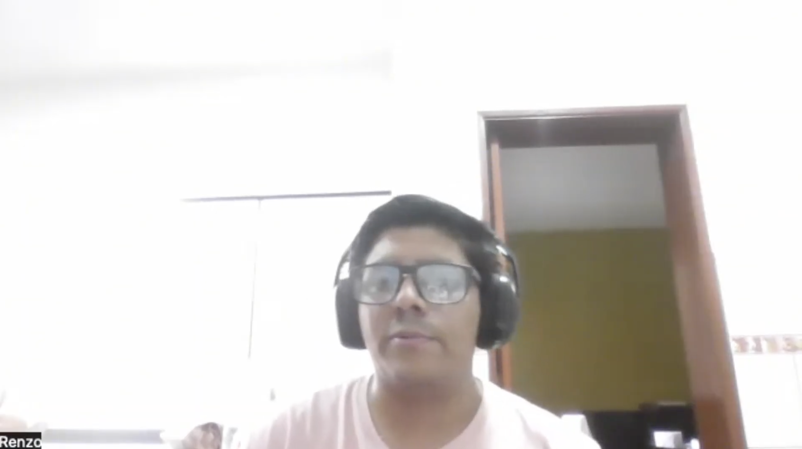

**Video de entrevista:** [Entrevista](https://drive.google.com/file/d/1lvKcFmLgGJu_Ca_NJWwq2QYOh67I5BB2/view?usp=share_link)

**Resumen:** El Ing. Vega administra una empresa agrícola de 8 hectáreas en la costa de Palpa, Ica, dedicada al cultivo de palta y cítricos con riego por goteo, bombeo y válvulas por sector. Tanto la verificación del riego como la inspección de plagas se realizan de forma manual, por lo que problemas frecuentes como mangueras desacopladas, fugas o goteros obstruidos tardan horas, o hasta el siguiente turno, en detectarse. Esto genera desperdicio de agua, sobrecostos de energía eléctrica o combustible para el bombeo y afectaciones en el rendimiento del cultivo por exceso o falta de riego.

Se mostró receptivo a una solución de gestión desde el smartphone que le envíe alertas puntuales. Para la gestión hídrica, prefiere recibir notificaciones cuando exista una diferencia de caudal y decidir él mismo el cierre remoto o manual de la válvula antes de habilitar un cierre totalmente automático. En el ámbito fitosanitario, valora que la cámara envíe la imagen, el tipo de plaga y el sector afectado para realizar intervenciones focalizadas. En lo comercial, solicita una entrada accesible mediante alquiler, suscripción mensual o un pago de instalación con mantenimiento económico, y evaluaría la compra definitiva tras comprobar el ahorro de agua e insumos.

##### Entrevista 2

| Campo | Detalle |
| :--- | :--- |
| **Nombres y apellidos** | Michael Quispe  |
| **Edad** | 24 años |
| **Distrito** | Cañete, Lima |
| **Ocupación** | Asistente técnico de riego |
| **Inicio en el video** | 00:09:00|
| **Duración** | 00:13:00|

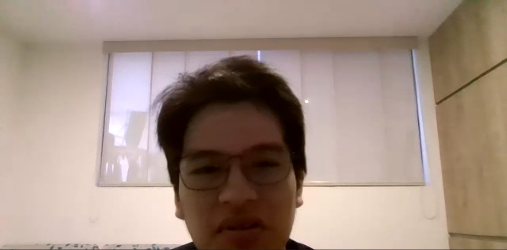

**Video de entrevista:** [Entrevista](https://upcedupe-my.sharepoint.com/:v:/g/personal/u202222846_upc_edu_pe/IQCAaAcW1oK_Tqof8YVhn2hPAeoTG09J7UKSdoKXZTXxL40?nav=eyJyZWZlcnJhbEluZm8iOnsicmVmZXJyYWxBcHAiOiJPbmVEcml2ZUZvckJ1c2luZXNzIiwicmVmZXJyYWxBcHBQbGF0Zm9ybSI6IldlYiIsInJlZmVycmFsTW9kZSI6InZpZXciLCJyZWZlcnJhbFZpZXciOiJNeUZpbGVzTGlua0NvcHkifX0&e=cwsQ3o)

**Resumen:** Michael Quispe trabaja como asistente técnico de riego en Cañete, Lima. Explicó que la detección de fugas depende de recorridos físicos por las parcelas, lo que retrasa la respuesta ante incidentes hidráulicos y provoca desperdicio de agua y daño al cultivo. Se mostró receptivo a recibir alertas en su celular y consideró que contar con evidencia fotográfica y con la opción de cerrar la válvula de forma remota reduciría significativamente el tiempo de reacción del personal de campo.

#### Segmento 2: Jefes de operaciones agrícolas y administradores de fundo

##### Entrevista 3

| Campo | Detalle |
| :--- | :--- |
| **Nombres y apellidos** | Alexis Alarcón Vargas |
| **Edad** | 32 años |
| **Distrito** | Cañete, Lima |
| **Ocupación** | Ingeniero agrónomo, jefe de Operaciones Agrícolas |
| **Inicio en el video** | hh:mm:ss <!-- completar --> |
| **Duración** | hh:mm:ss <!-- completar --> |

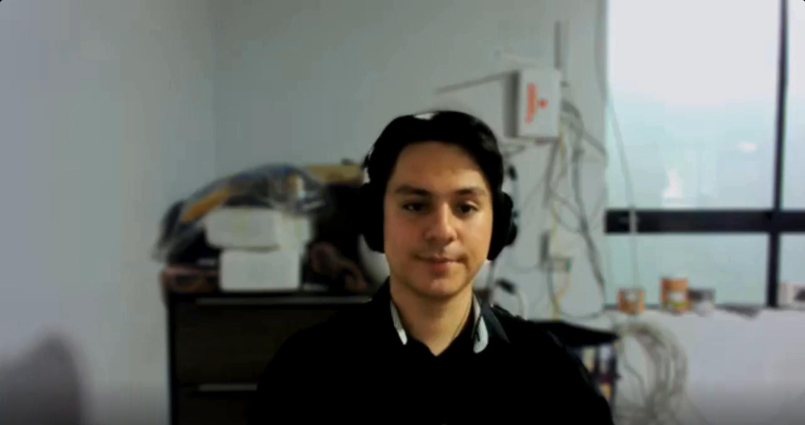

**Video de entrevista:** [Entrevista](https://upcedupe-my.sharepoint.com/:v:/g/personal/u202516291_upc_edu_pe/IQBUZID357uxQYUte2Gb4geMARDM9A0AdXGqjCBTxWvffuV?nav=eyJyZWZlcnJhbEluZm8iOnsicmVmZXJyYWxBcHAiOiJPbmVEcml2ZUZvckJ1c2luZXNzIiwicmVmZXJyYWxBcHBQbGF0Zm9ybSI6IldlYiIsInJlZmVycmFsTW9kZSI6InZpZXcifX0%3D&e=Lhg1P9)

**Resumen:** Alexis Alarcón Vargas, ingeniero agrónomo y jefe de Operaciones Agrícolas de la agroexportadora El Sur, supervisa el fundo San José, ubicado en el valle de Cañete. El fundo cuenta con 45 hectáreas (30 de palto Hass y 15 de uva de mesa) y utiliza riego por goteo automatizado desde casetas de bombeo. La programación del riego se realiza semanalmente según la evapotranspiración; sin embargo, el registro del volumen real de agua y de las presiones se lleva manualmente en cuadernos de campo, cuyos datos se transcriben a Excel al día siguiente.

Señaló que la falta de información en tiempo real retrasa la detección de errores humanos y roturas de líneas, afecta la uniformidad del riego y complica las auditorías. Indicó que ocurren entre tres y cinco fugas al mes debido a desacoples o fallas en mangueras y sellos. Estos incidentes generan sobrecostos de energía, desperdicio de fertilizantes disueltos y riesgos de penalización en certificaciones como GlobalG.A.P. y en auditorías de huella hídrica.

En sanidad vegetal, el fundo cuenta con evaluadores que monitorean plagas como queresa, arañita roja y trips. Los reportes pueden tardar entre 24 y 48 horas, por lo que las aplicaciones suelen abarcar lotes completos en lugar de focalizarse en las áreas afectadas. Utiliza diariamente una laptop y un smartphone, y consulta dashboards web y notificaciones push.

Respecto a la actuación automática de válvulas, considera necesarios interlocks que validen la persistencia de una anomalía y permisos con credenciales para autorizar la reapertura después de una inspección física. Valoró las alertas fitosanitarias con fotografía y porcentaje de confianza del modelo, que según su estimación podrían reducir hasta en un 30 % el consumo de productos fitosanitarios. Como indicadores útiles para un panel menciona el balance de caudal de entrada y salida en litros por minuto, el registro de incidencias, la bitácora de acciones sobre válvulas y la eficiencia hídrica. Finalmente, indicó que para una agroempresa sería adecuado un modelo SaaS B2B con suscripción por hectárea, que incluya el arrendamiento del hardware, la garantía y el mantenimiento, de modo que pueda gestionarse como gasto operativo.

### 2.2.3. Análisis de entrevistas

A continuación se analizan, por segmento, las características objetivas y subjetivas más comunes encontradas en las entrevistas. Los porcentajes se calculan sobre el total de entrevistados de cada segmento; **N/D** indica que la característica no se documentó en la entrevista. La muestra es de dos entrevistados en el Segmento 1 y uno en el Segmento 2, por lo que los porcentajes describen a los participantes y deben confirmarse con una muestra mayor.

#### Segmento 1: Pequeños y medianos agricultores tecnificados 

| Tipo | Característica | Resultado | % |
| :--- | :--- | :--- | :---: |
| Objetiva | Edad | Entre 24 y 27 años | 100 % |
| Objetiva | Ubicación | Valles agrícolas de la costa (Palpa, Ica; Cañete, Lima) | 100 % |
| Objetiva | Rol en la operación | Administra su empresa agrícola (Vega) / asistente técnico de riego (Quispe) | 50 % / 50 % |
| Objetiva | Riego por goteo con bombeo | Sí (Vega) / N/D (Quispe) | 50 % |
| Objetiva | Verifica el riego y busca fugas mediante recorridos o revisiones manuales | Sí | 100 % |
| Objetiva | Inspección de plagas manual | Sí (Vega) / N/D (Quispe) | 50 % |
| Subjetiva | Percibe que las fugas se detectan tarde (horas o hasta el siguiente turno) | Sí | 100 % |
| Subjetiva | Identifica desperdicio de agua y daño al cultivo como consecuencia principal | Sí | 100 % |
| Subjetiva | Menciona sobrecosto de energía de bombeo | Sí (Vega) / N/D (Quispe) | 50 % |
| Subjetiva | Receptivo a recibir alertas en el smartphone | Sí | 100 % |
| Subjetiva | Valora poder cerrar la válvula de forma remota | Sí | 100 % |
| Subjetiva | Prefiere decidir el cierre antes de habilitar un cierre automático | Sí (Vega) / N/D (Quispe) | 50 % |
| Subjetiva | Valora la evidencia fotográfica de plagas | Sí | 100 % |
| Subjetiva | Prefiere un modelo de entrada accesible (alquiler o suscripción) | Sí (Vega) / N/D (Quispe) | 50 % |

En este segmento, la totalidad de los entrevistados depende de revisiones manuales para encontrar fugas y percibe que las detecta tarde, con pérdida de agua y daño al cultivo. Ambos se mostraron receptivos a alertas en el smartphone, a la evidencia fotográfica y a cerrar la válvula a distancia. Los dos entrevistados son menores de 30 años, por debajo del rango de edad definido para el segmento en la sección 1.3.

#### Segmento 2: Jefes de operaciones agrícolas y administradores de fundo 

| Tipo | Característica | Resultado | % |
| :--- | :--- | :--- | :---: |
| Objetiva | Edad | 32 años | 100 % |
| Objetiva | Ubicación | Valle de Cañete, Lima | 100 % |
| Objetiva | Formación y rol | Ingeniero agrónomo, jefe de Operaciones Agrícolas de una agroexportadora | 100 % |
| Objetiva | Escala | 45 hectáreas (palto Hass y uva de mesa) | 100 % |
| Objetiva | Riego por goteo automatizado con casetas de bombeo | Sí | 100 % |
| Objetiva | Registra volúmenes y presiones manualmente (cuaderno y Excel) | Sí | 100 % |
| Objetiva | Frecuencia de fugas | Entre 3 y 5 al mes | 100 % |
| Objetiva | Monitoreo de plagas con evaluadores, reportes en 24 a 48 horas | Sí | 100 % |
| Objetiva | Dispositivos de uso diario | Laptop y smartphone; dashboards web y notificaciones push | 100 % |
| Subjetiva | Considera que la falta de información en tiempo real retrasa la detección y complica las auditorías | Sí | 100 % |
| Subjetiva | Exige interlocks y credenciales antes de permitir el cierre o la reapertura automática | Sí | 100 % |
| Subjetiva | Valora alertas fitosanitarias con fotografía y porcentaje de confianza | Sí | 100 % |
| Subjetiva | Prefiere un modelo SaaS por hectárea con arrendamiento de hardware | Sí | 100 % |

El representante de este segmento gestiona el riego a mayor escala y con registros manuales que se consolidan al día siguiente. Sus prioridades son la trazabilidad para auditorías y certificaciones, el control de costos y las salvaguardas antes de automatizar la actuación sobre las válvulas.

#### Coincidencias entre segmentos 

| Característica | % |
| :--- | :---: |
| Detección de fugas mediante revisiones o registros manuales | 100 % |
| Percepción de detección tardía de incidentes | 100 % |
| Receptividad a alertas en el smartphone | 100 % |
| Valoración de la evidencia fotográfica de plagas | 100 % |
| Riego por goteo con bombeo | 67 % (33 % N/D) |
| Preferencia por control humano o salvaguardas antes del cierre automático | 67 % (33 % N/D) |
| Preferencia por suscripción o alquiler en lugar de compra | 67 % (33 % N/D) |

## 2.3. Needfinding

En esta sección se presentan los artefactos elaborados a partir del análisis de entrevistas de la sección 2.2.3 y del análisis competitivo de la sección 2.1. Se construyó un User Persona por segmento en UXPressia y, sobre cada uno, su User Journey Map *As-Is* y su Empathy Map. La matriz de tareas compara las actividades que ambos User Personas realizan actualmente, sin considerar la solución.

**Trazabilidad de la evidencia.** Cada característica de los artefactos se vincula con un hallazgo de las entrevistas mediante un código: **E1** corresponde al Ing. Vega, **E2** a Michael Quispe y **E3** a Alexis Alarcón Vargas.

| ID | Evidencia | Entrevista |
| :--- | :--- | :--- |
| E1-A | Administra una empresa agrícola de 8 ha de palta y cítricos en Palpa (Ica), con riego por goteo, bombeo y válvulas por sector. | Entrevista 1 · Segmento 1 |
| E1-B | La verificación del riego y la inspección de plagas son manuales; desacoples, fugas u obstrucciones tardan horas o hasta el siguiente turno en detectarse. | Entrevista 1 · Segmento 1 |
| E1-C | Las fallas no detectadas generan desperdicio de agua, sobrecosto de energía o combustible de bombeo y pérdida de rendimiento. | Entrevista 1 · Segmento 1 |
| E1-D | Receptivo a alertas puntuales en el smartphone; prefiere decidir el cierre remoto o manual de la válvula antes de habilitar un cierre automático. | Entrevista 1 · Segmento 1 |
| E1-E | Valora recibir la imagen, el tipo de plaga y el sector afectado para intervenir de forma focalizada. | Entrevista 1 · Segmento 1 |
| E1-F | Prefiere una entrada accesible (alquiler, suscripción o instalación con mantenimiento) y compraría tras comprobar el ahorro. | Entrevista 1 · Segmento 1 |
| E2-A | Asistente técnico de riego, 24 años, Cañete (Lima). | Entrevista 2 · Segmento 1 |
| E2-B | La detección de fugas depende de recorridos físicos, lo que retrasa la respuesta y genera desperdicio de agua y daño al cultivo. | Entrevista 2 · Segmento 1 |
| E2-C | Considera que las alertas móviles, la evidencia fotográfica y el cierre remoto reducirían el tiempo de reacción. | Entrevista 2 · Segmento 1 |
| E3-A | Ingeniero agrónomo, jefe de Operaciones Agrícolas; supervisa 45 ha de palto Hass y uva de mesa con riego por goteo automatizado. | Entrevista 3 · Segmento 2 |
| E3-B | Programa el riego semanalmente según la evapotranspiración; registra volúmenes y presiones en cuadernos que se transcriben a Excel al día siguiente. | Entrevista 3 · Segmento 2 |
| E3-C | Entre 3 y 5 fugas al mes; generan sobrecosto de energía, desperdicio de fertilizantes y riesgo en certificaciones y auditorías. | Entrevista 3 · Segmento 2 |
| E3-D | Evaluadores monitorean queresa, arañita roja y trips; los reportes tardan entre 24 y 48 horas y las aplicaciones cubren lotes completos. | Entrevista 3 · Segmento 2 |
| E3-E | Usa laptop y smartphone a diario; consulta dashboards web y notificaciones push. | Entrevista 3 · Segmento 2 |
| E3-F | Exige interlocks y credenciales para el cierre automático y la reapertura tras una inspección física. | Entrevista 3 · Segmento 2 |
| E3-G | Valora alertas con fotografía y porcentaje de confianza; requiere balance de caudal, incidencias, bitácora de válvulas y eficiencia hídrica. | Entrevista 3 · Segmento 2 |
| E3-H | Prefiere un modelo SaaS por hectárea con arrendamiento de hardware, garantía y mantenimiento. | Entrevista 3 · Segmento 2 |

### 2.3.1. User Personas

Las User Personas se elaboraron en UXPressia y representan las características más comunes de cada segmento según el análisis de entrevistas. Del análisis competitivo se tomó que las soluciones existentes son costosas o no actúan sobre la infraestructura, por lo que las fichas destacan las condiciones de adopción y la necesidad de control sobre la válvula.

**User Persona del Segmento 1: Ing. Vega · Productor tecnificado**

Representa al pequeño o mediano productor con riego tecnificado. Tiene 27 años y administra una empresa agrícola de 8 hectáreas de palta y cítricos en Palpa, Ica, con riego por goteo y válvulas por sector (E1-A). Su objetivo es detectar a tiempo fugas, desacoples y obstrucciones y evitar el desperdicio de agua y energía (E1-B, E1-C, E2-B). Su principal frustración es depender de revisiones manuales que descubren las fallas horas después (E1-B, E2-B). Usa el smartphone y está dispuesto a recibir alertas, pero quiere decidir él mismo el cierre de la válvula (E1-D, E2-C). Adoptaría la solución mediante alquiler o suscripción y tras comprobar el ahorro (E1-F).

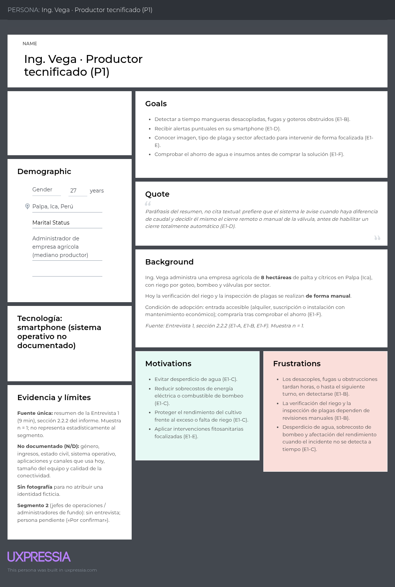

**User Persona del Segmento 2: Alexis Alarcón · Jefe de operaciones agrícolas**

Representa al profesional que gestiona el riego y la sanidad vegetal de un fundo de mayor escala. Tiene 32 años, es ingeniero agrónomo y supervisa 45 hectáreas de palto Hass y uva de mesa en Cañete (E3-A). Su objetivo es contar con información en tiempo real para controlar costos, cumplir auditorías y focalizar las aplicaciones fitosanitarias (E3-C, E3-D, E3-G). Sus frustraciones son los registros manuales que se consolidan al día siguiente y los reportes de plagas que tardan hasta 48 horas (E3-B, E3-D). Trabaja con laptop y smartphone, consulta dashboards web y exige salvaguardas antes de automatizar el cierre de válvulas (E3-E, E3-F).

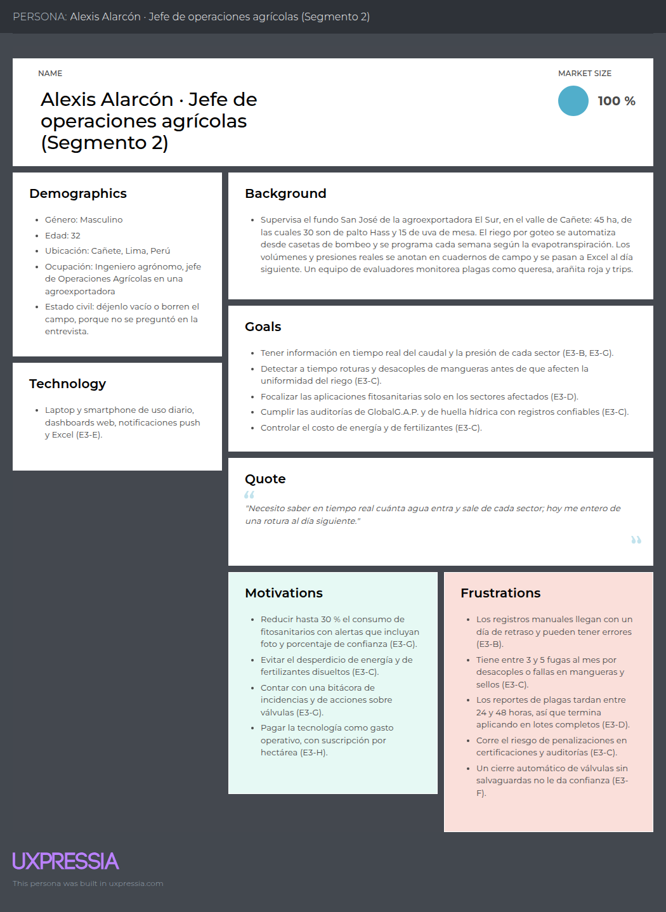

### 2.3.2. User Task Matrix

La matriz compara las tareas que realizan actualmente el Ing. Vega (Segmento 1) y Alexis Alarcón (Segmento 2) para supervisar el riego y la sanidad vegetal, independientemente de la existencia de AgroLeak. Para cada tarea se indica la frecuencia y la importancia en una escala de Alta, Media y Baja, según lo descrito en las entrevistas.

| Tarea | Ing. Vega (S1): Frecuencia | Ing. Vega (S1): Importancia | Alexis Alarcón (S2): Frecuencia | Alexis Alarcón (S2): Importancia |
| :--- | :---: | :---: | :---: | :---: |
| Programar los turnos y volúmenes de riego | Media | Alta | Media | Alta |
| Recorrer el campo para verificar que el agua llegue a cada sector | Alta | Alta | Alta | Media |
| Registrar manualmente caudales y presiones | Baja | Media | Alta | Alta |
| Detectar y localizar fugas, desacoples u obstrucciones | Alta | Alta | Alta | Alta |
| Cerrar o abrir manualmente una válvula ante una falla | Media | Alta | Media | Alta |
| Coordinar la reparación con el personal de campo | Media | Media | Media | Alta |
| Inspeccionar y reportar plagas en el cultivo | Media | Alta | Alta | Alta |
| Decidir aplicaciones fitosanitarias | Baja | Alta | Media | Alta |
| Controlar los costos de agua, energía y fertilizantes | Baja | Alta | Media | Alta |
| Preparar información para auditorías y certificaciones | Baja | Baja | Baja | Alta |

Las tareas con mayor frecuencia e importancia para ambos User Personas son recorrer el campo y detectar fugas o desacoples, que hoy dependen de revisiones manuales. Ambos también realizan el cierre manual de válvulas e inspeccionan plagas con alta importancia. La principal diferencia está en la gestión de la información: Alexis Alarcón registra caudales y presiones a diario, controla costos y prepara información para auditorías, mientras que para el Ing. Vega estas tareas son ocasionales y su prioridad es la detección rápida en campo.

### 2.3.3. User Journey Mapping

Los User Journey Maps *As-Is* se elaboraron en UXPressia y están vinculados al User Persona de cada segmento. Representan el recorrido actual, sin AgroLeak, desde la operación del riego hasta la atención de una falla, y muestran por etapa las acciones, los puntos de contacto, los problemas, las emociones y las oportunidades.

**Journey Map del Segmento 1: Ing. Vega**

El recorrido tiene cuatro etapas: operación del riego, verificación manual, detección tardía de la falla y atención y corrección. El punto más bajo ocurre en la detección tardía, cuando la fuga ya provocó desperdicio de agua y sobrecosto de bombeo (E1-B, E1-C). Las oportunidades son recibir alertas por diferencia de caudal en el smartphone y cerrar la válvula a distancia (E1-D, E2-C).

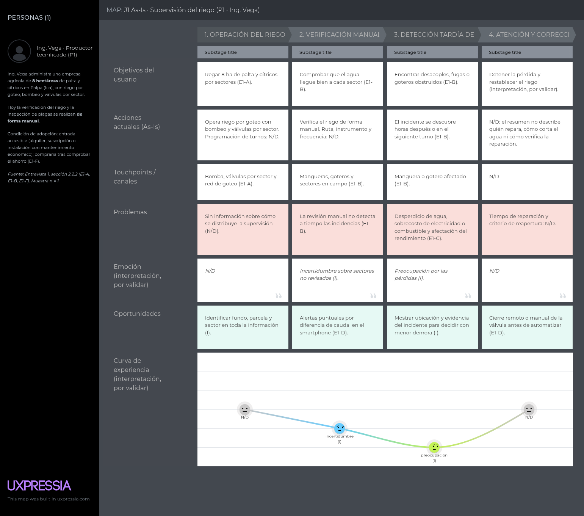

**Journey Map del Segmento 2: Alexis Alarcón**

El recorrido tiene cinco etapas: programación semanal del riego, registro manual de lecturas, detección de incidencias y plagas, decisión e intervención, y consolidación para auditoría. El punto más bajo ocurre cuando la información llega al día siguiente y las aplicaciones fitosanitarias deben cubrir lotes completos (E3-B, E3-D). Las oportunidades son el balance de caudal en tiempo real, las alertas con fotografía y la bitácora de acciones sobre válvulas (E3-G).

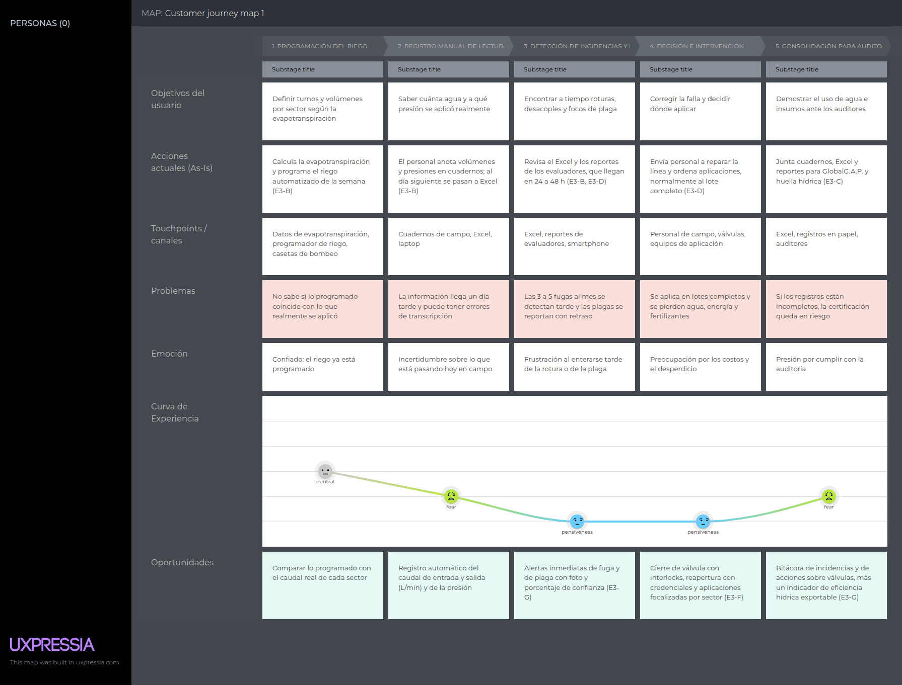

### 2.3.4. Empathy Mapping

Los Empathy Maps se elaboraron en UXPressia con el User Persona al centro. Cada integrante del equipo registró sus observaciones respondiendo a las preguntas ¿con quién estamos empatizando?, ¿qué necesita hacer?, ¿qué está viendo?, ¿qué está diciendo?, ¿qué está haciendo?, ¿qué está escuchando? y ¿qué piensa y siente? Luego se identificaron los pains y gains de cada User Persona.

**Empathy Map del Segmento 1: Ing. Vega**

**Necesita** detectar a tiempo desacoples, fugas y obstrucciones, y decidir el cierre de la válvula ante una diferencia de caudal (E1-B, E1-D). **Ve** fallas que se descubren horas después y cultivos afectados por exceso o falta de riego (E1-B, E1-C). **Hace** revisiones manuales del riego y de las plagas (E1-B, E2-B). **Dice** que prefiere recibir avisos y decidir él mismo antes de automatizar el cierre (E1-D). Sus **pains** son la detección tardía y los sobrecostos de bombeo; sus **gains**, las alertas en el smartphone, la evidencia fotográfica y un ahorro comprobable antes de comprar (E1-C, E1-E, E1-F).

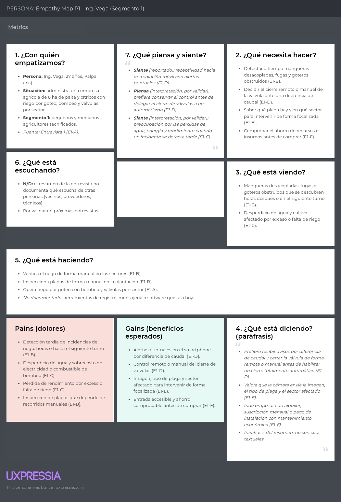

**Empathy Map del Segmento 2: Alexis Alarcón**

**Necesita** información confiable y oportuna para controlar costos, cumplir auditorías y focalizar las aplicaciones (E3-C, E3-G). **Ve** registros que llegan al día siguiente y reportes de plagas que tardan hasta 48 horas (E3-B, E3-D). **Hace** la programación semanal del riego y consolida datos de cuadernos en Excel (E3-B). **Dice** que cualquier cierre automático debe tener interlocks y que la reapertura requiere credenciales tras una inspección (E3-F). Sus **pains** son la falta de información en tiempo real y el riesgo en certificaciones; sus **gains**, el balance de caudal en tiempo real, las alertas con fotografía y un modelo de suscripción por hectárea (E3-G, E3-H).

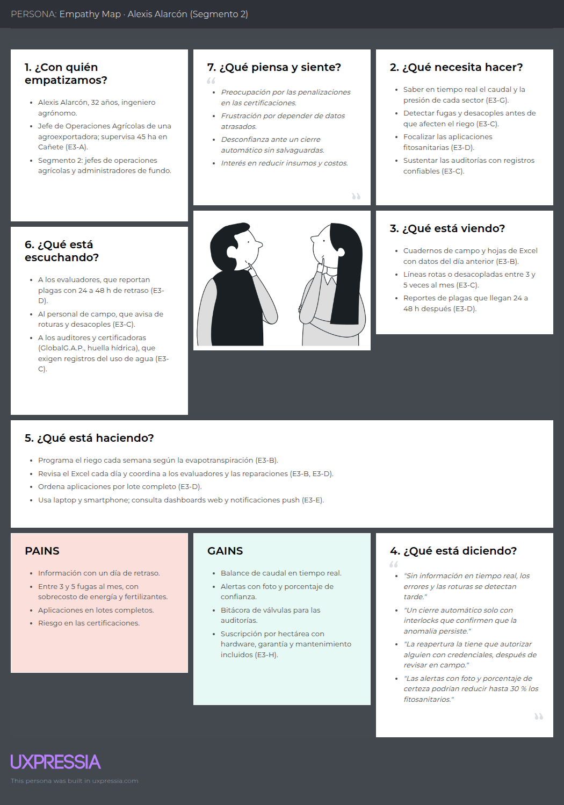

## 2.4. Big Picture Event Storming

El Big Picture Event Storming de AgroLeak se elaboró en Miro para representar los eventos del dominio, las acciones que los originan, los actores y sistemas participantes, y las reglas que conectan los procesos. Los siguientes pasos muestran el desarrollo del modelado, desde la identificación de eventos hasta la delimitación de los Bounded Contexts.

### Paso 1: Domain Events — Eventos de dominio

Se identifican los hechos relevantes que ocurren en el dominio y se expresan en pasado. Estos eventos permiten describir qué sucede en AgroLeak durante la configuración del fundo, el monitoreo del riego, la detección de plagas y la atención de alertas.

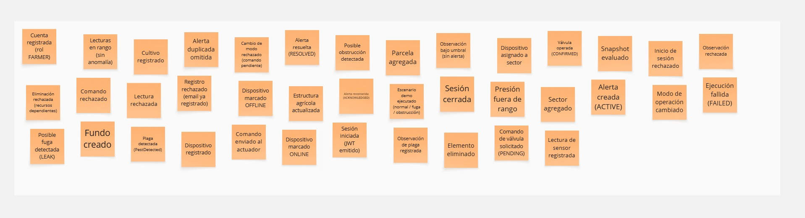

### Paso 2: Timelines — Ordenar los eventos

Los eventos identificados se organizan cronológicamente de izquierda a derecha para representar la secuencia de cada proceso y hacer visibles las alternativas y excepciones.

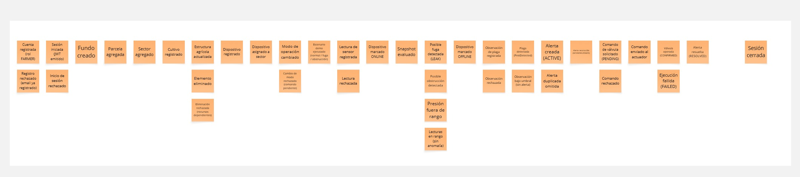

### Paso 3: Commands — Identificar comandos

Se incorporan las acciones o solicitudes que pueden provocar los eventos, expresadas como comandos. Cada comando debe estar relacionado con el actor o sistema que lo inicia y con el resultado que produce.

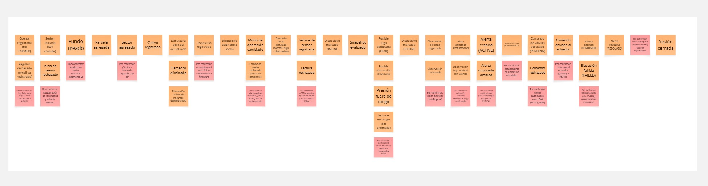

### Paso 4: Actors — Identificar actores

Se identifican los usuarios y roles que participan en los procesos y que pueden iniciar comandos o responder a eventos, de acuerdo con las responsabilidades definidas para AgroLeak.

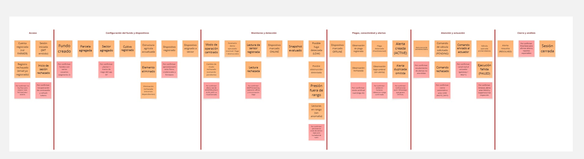

### Paso 5: Hotspots — Identificar puntos de atención

Se señalan dudas, problemas, excepciones y decisiones pendientes que requieren aclaración del equipo o validación con los usuarios. Los hotspots ayudan a distinguir las reglas confirmadas de los aspectos aún no resueltos.

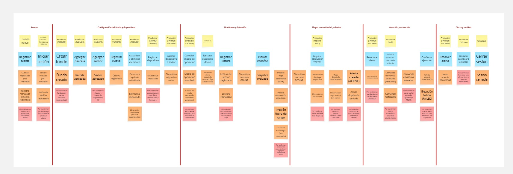

### Paso 6: Policies — Reglas de negocio y reacciones automáticas

Se identifican las políticas que reaccionan a eventos y pueden iniciar comandos o generar nuevos eventos. En AgroLeak, este paso permite documentar las reglas que relacionan las lecturas de caudal, la detección de anomalías, la generación de alertas y las solicitudes de actuación, según lo definido en el dominio.

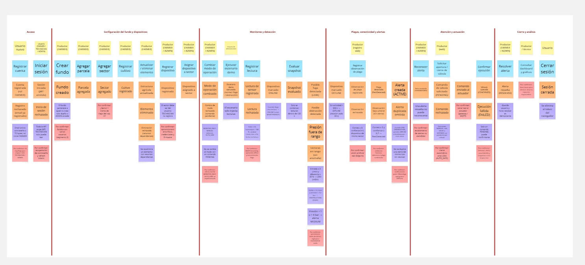

### Paso 7: Read Models — Información consultada para decidir

Se representan las vistas de información que necesitan los usuarios o sistemas para consultar el estado del proceso y tomar decisiones, por ejemplo, la información de monitoreo, alertas o historial que efectivamente contempla el sistema.

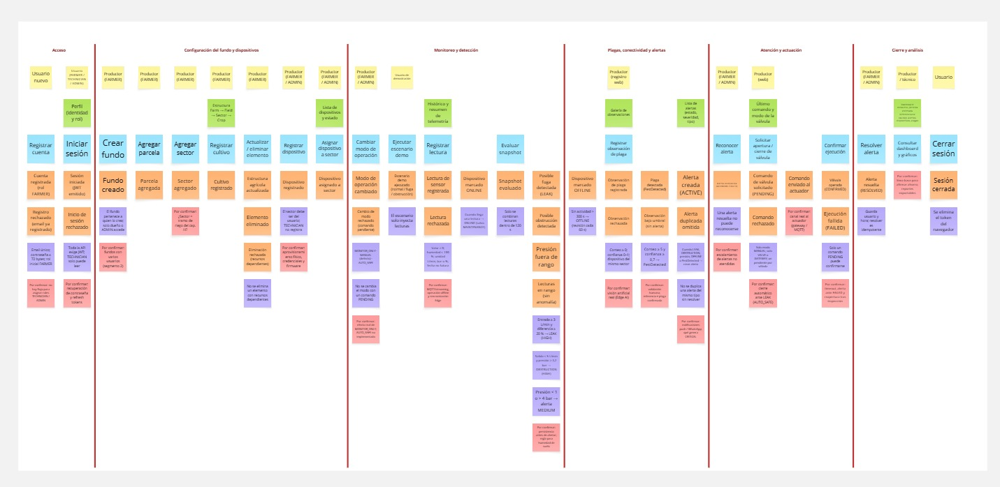

### Paso 8: External Systems — Dispositivos y sistemas externos

Se identifican los dispositivos y sistemas externos que participan en los flujos, tales como sensores, cámaras, gateway, actuadores o servicios de comunicación, de acuerdo con su participación en la solución.

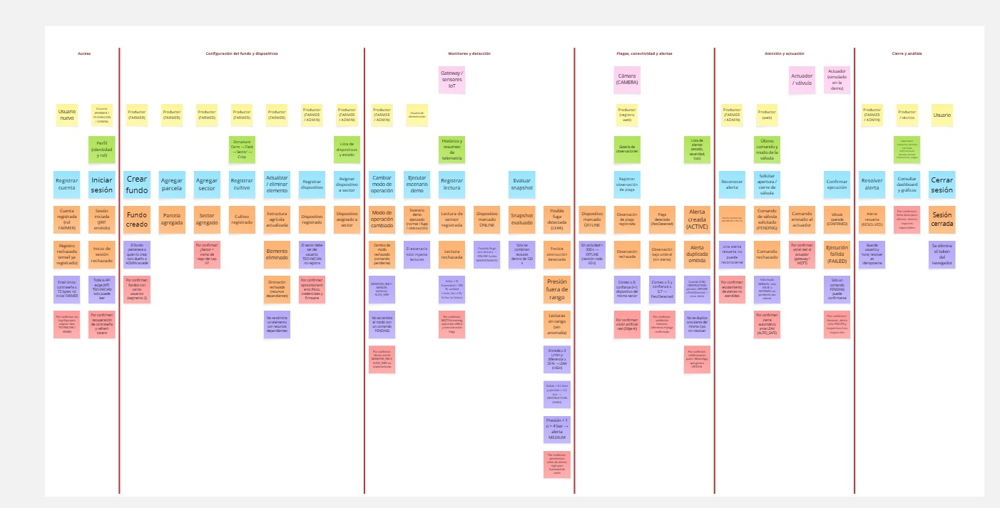

### Paso 9: Aggregates — Agregados

Se agrupan los eventos y comandos alrededor de los agregados que protegen las reglas e invariantes del dominio. Cada agregado recibe comandos y, cuando corresponde, emite eventos que reflejan el resultado de la operación.

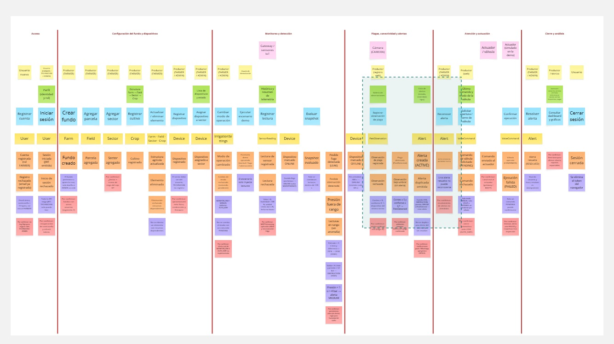

### Paso 10: Bounded Contexts — Contextos delimitados

Se delimitan los contextos a partir de las responsabilidades del dominio, agrupando sus agregados y relacionándolos mediante las políticas o interacciones correspondientes. Los límites representan modelos con lenguaje y responsabilidades consistentes; no implican necesariamente que cada contexto sea una aplicación o un microservicio independiente.

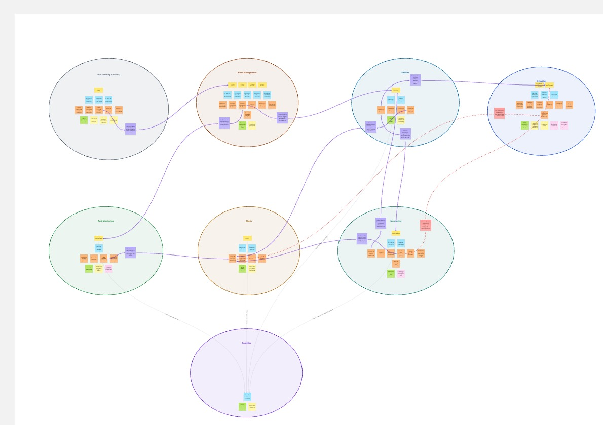

## 2.5. Ubiquitous Language

El Ubiquitous Language reúne los términos del dominio del riego tecnificado y la sanidad vegetal que comparten los usuarios, el equipo y los artefactos del proyecto. Los términos se presentan en inglés, con su equivalente en español entre paréntesis, y se obtuvieron de las entrevistas y del Big Picture Event Storming.

| Término | Definición |
| :--- | :--- |
| **Farm (Fundo)** | Unidad de producción agrícola administrada por un productor o por el equipo de operaciones de una agroempresa. |
| **Field (Parcela)** | Área de cultivo dentro de un fundo. |
| **Irrigation Sector (Sector de riego)** | Parte de una parcela que se riega desde una misma válvula y en la que se supervisa el caudal. Es la unidad a la que se asocian cultivos y dispositivos; en campo también se le llama tramo de riego. |
| **Crop (Cultivo)** | Especie y variedad sembrada en un sector, con su fecha de siembra y estado. |
| **Drip Irrigation (Riego por goteo)** | Sistema de riego que entrega agua a las plantas mediante mangueras y goteros, impulsada por una estación de bombeo. |
| **Pumping Station (Caseta de bombeo)** | Instalación que impulsa el agua hacia la red de riego; su consumo de energía o combustible es un costo operativo relevante. |
| **Irrigation Schedule (Programación de riego)** | Plan de turnos y volúmenes de riego por sector, que puede definirse según la evapotranspiración del cultivo. |
| **Evapotranspiration (Evapotranspiración)** | Cantidad de agua que pierde el cultivo por evaporación del suelo y transpiración de las plantas; se usa como referencia para programar el riego. |
| **Flow Rate (Caudal)** | Volumen de agua que pasa por un punto de la red de riego por unidad de tiempo, expresado en litros por minuto (L/min). |
| **Inflow / Outflow (Caudal de entrada / salida)** | Caudal medido al inicio y al final de un sector de riego. |
| **Flow Balance (Balance de caudal)** | Diferencia entre el caudal de entrada y el de salida de un sector, expresada como porcentaje del caudal de entrada. |
| **Irrigation Pressure (Presión de riego)** | Presión del agua en la red de riego, expresada en bar; una presión fuera del rango normal indica una falla. |
| **Leak (Fuga)** | Pérdida de agua en la red de riego por rotura, desacople de mangueras o falla de sellos. Se identifica cuando el caudal de salida es significativamente menor que el de entrada. |
| **Obstruction (Obstrucción)** | Bloqueo de goteros o tuberías que reduce el caudal de salida y eleva la presión de la red. |
| **Persistent Flow Anomaly (Anomalía persistente de caudal)** | Diferencia de caudal o presión fuera de los umbrales configurados que se mantiene durante el tiempo definido; una lectura aislada no constituye una anomalía persistente. |
| **Field Log (Registro de campo)** | Anotación manual de volúmenes, presiones e incidencias en cuadernos de campo. |
| **IoT Device (Dispositivo IoT)** | Sensor de caudal, presión o humedad, cámara, válvula o gateway instalado en un sector. |
| **Device Status (Estado del dispositivo)** | Condición de conexión de un dispositivo: en línea (*ONLINE*) o sin conexión (*OFFLINE*) cuando deja de reportar durante el tiempo establecido. |
| **Shutoff Valve (Válvula de corte)** | Actuador que abre o cierra el paso de agua hacia un sector. |
| **Valve Command (Comando de válvula)** | Orden de apertura (*OPEN*) o cierre (*CLOSE*) enviada a una válvula. |
| **Command Status (Estado del comando)** | Resultado de un comando de válvula: pendiente (*PENDING*), confirmado (*CONFIRMED*) o fallido (*FAILED*). Un comando enviado no se considera ejecutado hasta que la válvula lo confirma. |
| **Operation Mode (Modo de operación)** | Configuración de un sector que define cómo se actúa sobre la válvula: solo monitoreo (*MONITOR_ONLY*), actuación manual (*MANUAL*) o cierre automático protegido (*AUTO_SAFE*). |
| **Interlock (Bloqueo de seguridad)** | Condición que debe cumplirse antes de ejecutar un cierre automático, como confirmar que la anomalía es persistente. |
| **Reopening Authorization (Autorización de reapertura)** | Permiso que otorga un usuario autorizado para volver a abrir una válvula después de una inspección física. |
| **Pest (Plaga)** | Organismo que daña el cultivo, como queresa, arañita roja o trips. |
| **Phytosanitary Evaluation (Evaluación fitosanitaria)** | Inspección del cultivo realizada por evaluadores para identificar y cuantificar plagas. |
| **Pest Observation (Observación de plaga)** | Registro de una plaga detectada en un sector, con su imagen, tipo, cantidad y nivel de confianza. |
| **Detection Confidence (Confianza de detección)** | Porcentaje que indica qué tan seguro está el modelo de visión artificial de la plaga que identificó; no reemplaza la confirmación del evaluador. |
| **Targeted Application (Aplicación focalizada)** | Aplicación de productos fitosanitarios solo en el sector afectado, en lugar de todo el lote. |
| **Alert (Alerta)** | Aviso al usuario sobre una fuga, obstrucción, presión fuera de rango, dispositivo sin conexión o plaga detectada. |
| **Alert Status (Estado de la alerta)** | Etapa de atención de una alerta: activa (*ACTIVE*), reconocida (*ACKNOWLEDGED*) o resuelta (*RESOLVED*). |
| **Audit Log (Bitácora)** | Registro con fecha, hora y usuario de las incidencias y de las acciones realizadas sobre alertas y válvulas. |
| **Estimated Water Loss (Pérdida estimada de agua)** | Volumen de agua perdido calculado a partir del balance de caudal durante un periodo. |
| **Water Efficiency (Eficiencia hídrica)** | Relación entre el agua que llega efectivamente al cultivo y el agua bombeada. |
| **Water Footprint (Huella hídrica)** | Volumen de agua utilizado en la producción, evaluado en certificaciones y auditorías ambientales. |

Los nombres y definiciones de esta tabla constituyen la base del lenguaje de dominio a partir del Event Storming, la lógica de la aplicación y la entrevista del Segmento 2. Los términos recogidos de una entrevista reflejan lo expresado por ese participante; no implican por sí solos que AgroLeak ya implemente o haya aprobado esas reglas o métricas. Deben contrastarse con las demás entrevistas y mantenerse consistentes en los requisitos, diseños y diagramas. En particular, el equipo debe confirmar si **sector** y **tramo de riego** representan la misma unidad, y validar los estados y transiciones de alertas, dispositivos y comandos de válvula con la implementación.

Los nombres y definiciones de esta tabla constituyen la base del lenguaje de dominio a partir del Event Storming, la lógica de la aplicación y la entrevista del Segmento 2. Los términos recogidos de una entrevista reflejan lo expresado por ese participante; no implican por sí solos que AgroLeak ya implemente o haya aprobado esas reglas o métricas. Deben contrastarse con las demás entrevistas y mantenerse consistentes en los requisitos, diseños y diagramas. En particular, el equipo debe confirmar si **sector** y **tramo de riego** representan la misma unidad, y validar los estados y transiciones de alertas, dispositivos y comandos de válvula con la implementación.

